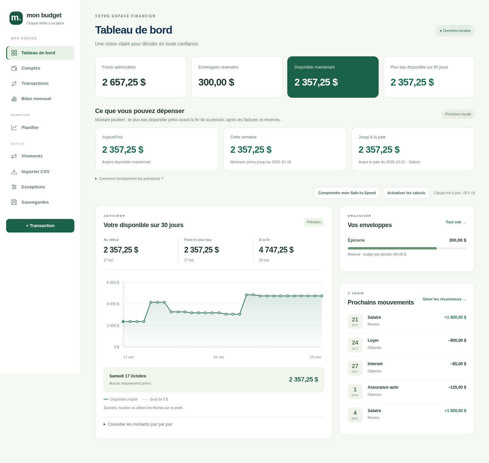
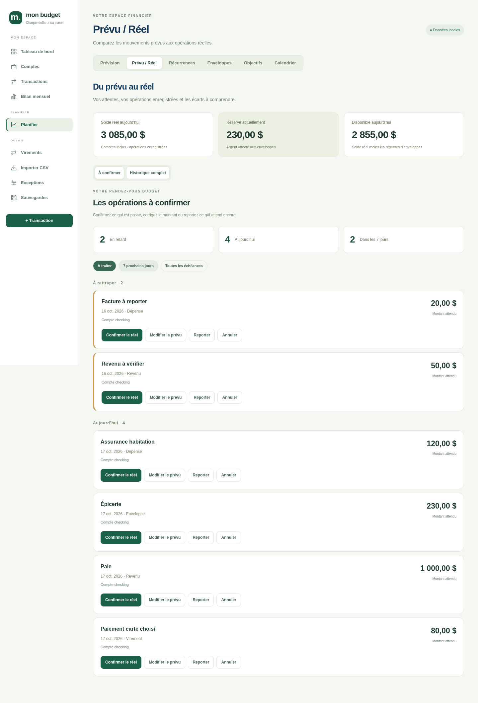
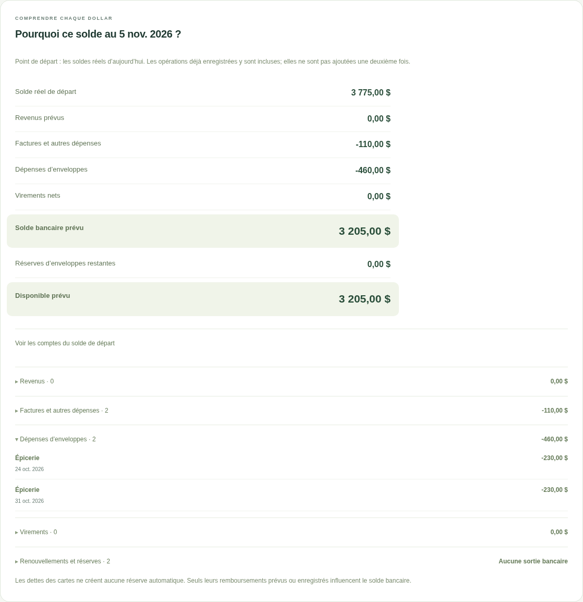
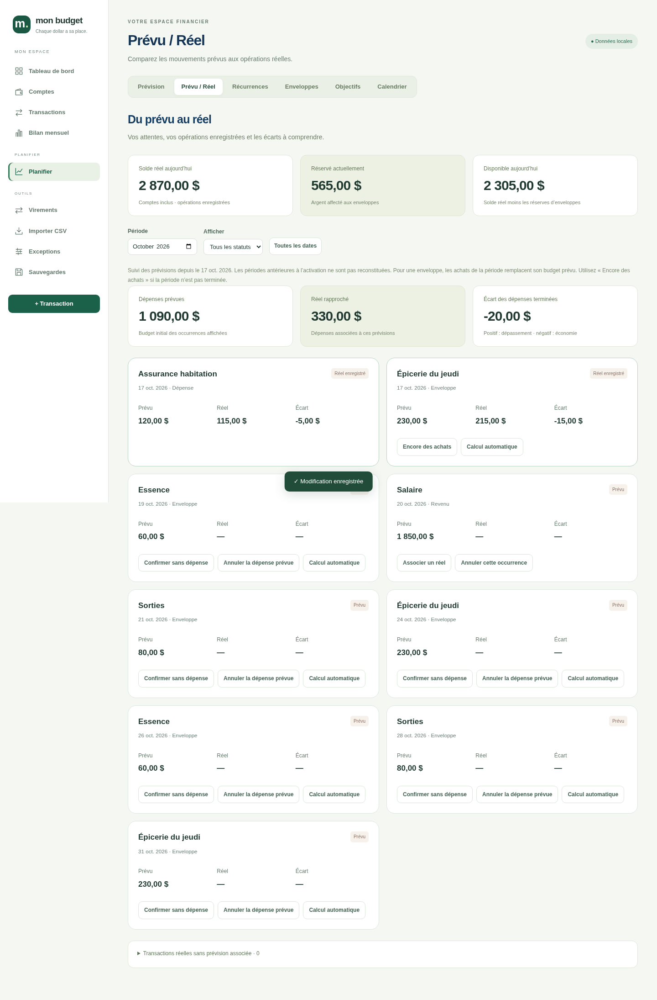
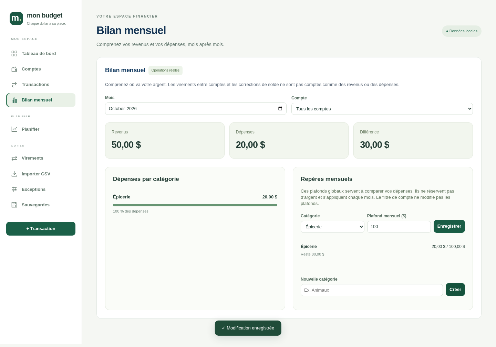
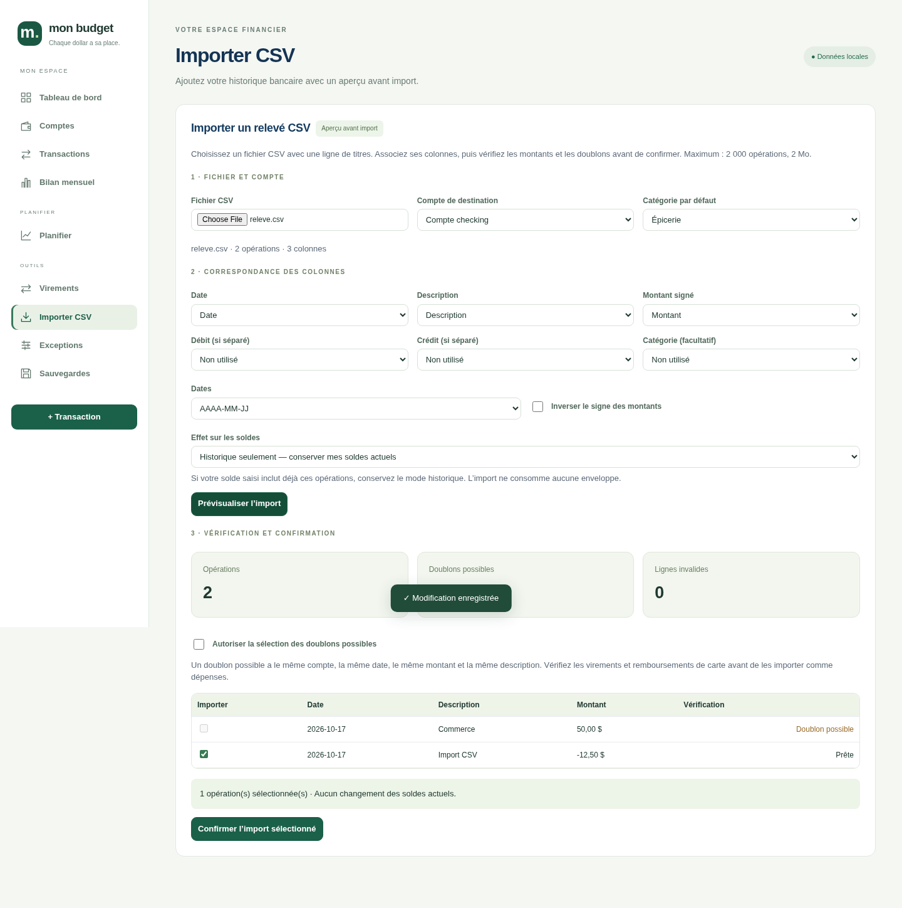
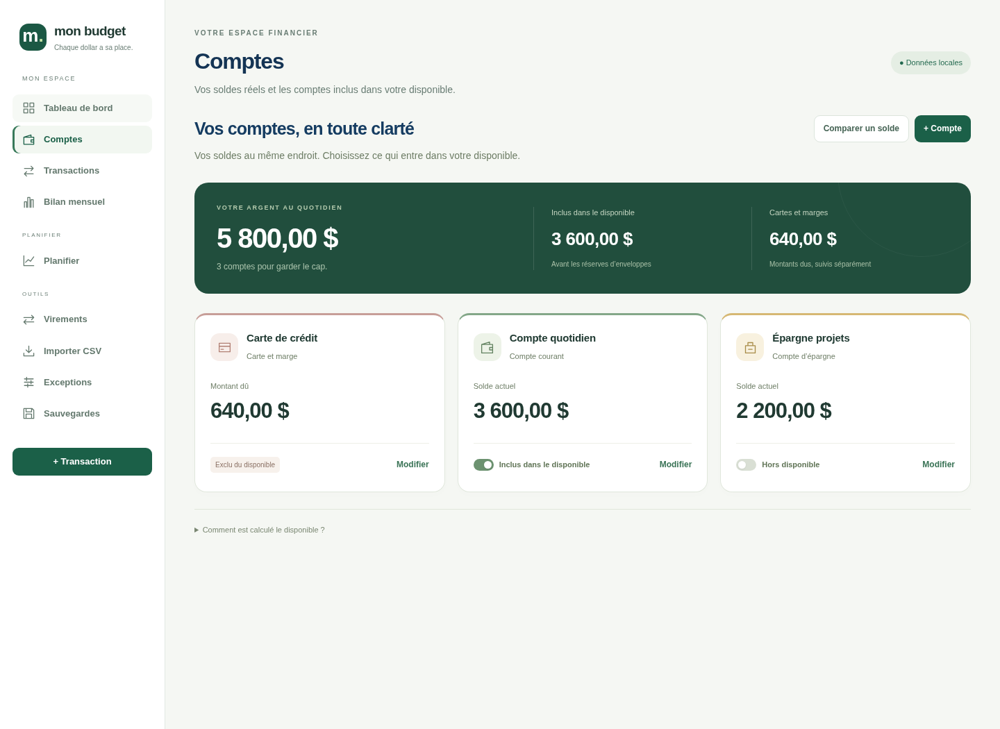
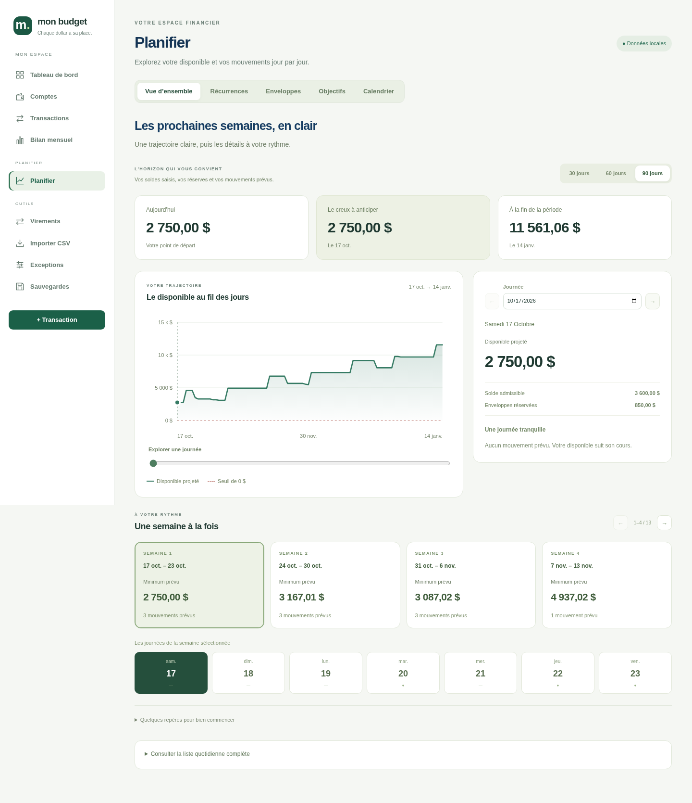
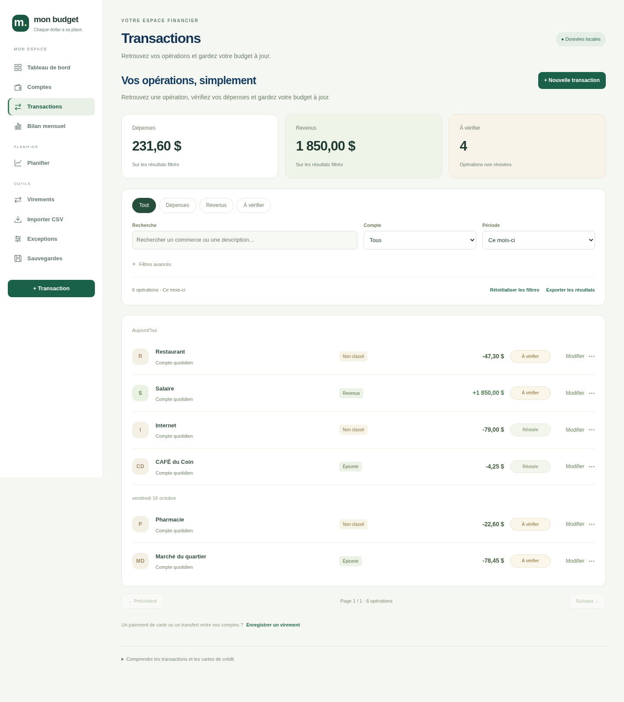
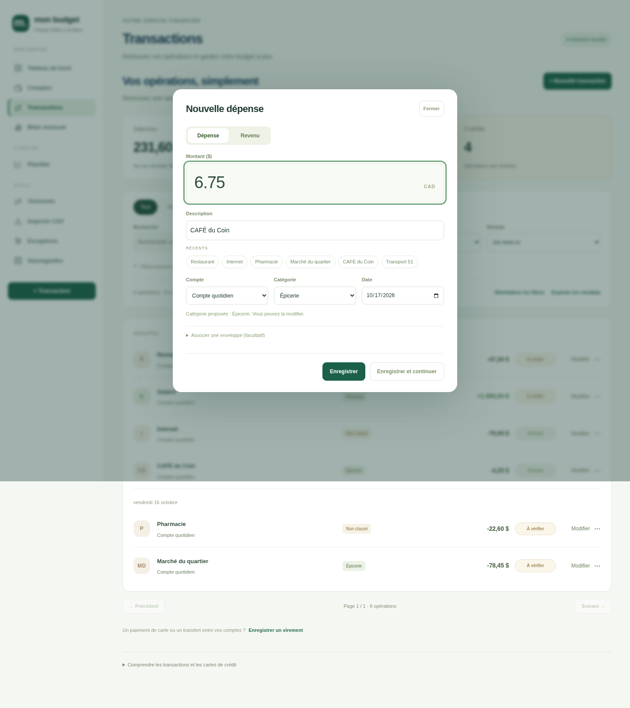

# Mon Budget 7.1

Application de budget locale, en français canadien, pour Mac. Vos données restent dans une base SQLite sur votre ordinateur. Node.js **22.13 ou plus** est requis; Node.js 24 LTS est recommandé. Aucun CDN, aucune compilation et aucune dépendance npm externe.

```sh
npm start
```

Ouvrez `http://127.0.0.1:3030`. Le serveur écoute uniquement sur l’interface locale. Il crée `data/` dans le dossier depuis lequel il est lancé. Les fichiers de l’application doivent rester ensemble.

## Nouveautés 7.1 : Conjoint, trois cartes et virements personnels

Les **virements entre comptes restent disponibles**, déjà effectués ou programmés. Une sortie de Conjoint vers un compte personnel réduit son disponible; le solde du compte personnel ne finance pas le Safe-to-Spend commun. Aucun lien à une facture n’est nécessaire dans la nouvelle configuration.

Dans **Comptes → Configurer mes comptes de dépenses** (également accessible dans Bien démarrer, étape 3), choisissez Conjoint et vos cartes existantes : **CIBC MasterCard**, **Capital One MasterCard**, **VISA Desjardins**. Si elles manquent, ajoutez-les d’abord avec leur solde réel, puis revenez à la configuration. Les formulaires de nouvelles dépenses et de factures proposent ensuite ces comptes; tous les comptes restent accessibles pour les virements et les revenus. Les opérations historiques et imports restent consultables.

**Voir les changements** affiche les factures actives des autres comptes qui seront réaffectées à Conjoint, ainsi que les enveloppes à paiement daté. Les montants et calendriers sont conservés. Les transactions déjà enregistrées et les soldes ne sont pas réécrits; les factures déjà rapprochées restent réglées. Les anciens virements réguliers vers les comptes personnels sont proposés séparément : cochez uniquement ceux à suspendre. Les autres restent actifs et continuent d’influencer la prévision. L’application ne suppose pas qu’un virement personnel est devenu inutile.

Cliquez sur **Appliquer cette configuration** après vérification. Un aperçu périmé est refusé. Les anciens liens de financement v7.0 d’une facture à déplacer doivent d’abord être retirés dans Bien démarrer, étape 7; leurs écritures bancaires restent conservées. La configuration peut être annulée avec l’annulation de la dernière modification et elle est incluse dans les sauvegardes.

**Cartes** : un achat augmente la dette sans créer de réserve automatique de remboursement. Un remboursement depuis Conjoint se saisit comme un virement vers la carte et diminue le disponible. Exemple : 1 000 $ dans Conjoint, virement personnel de 75 $ → 925 $; achat CIBC de 100 $ → dette de 100 $, disponible toujours 925 $; remboursement CIBC de 100 $ → disponible de 825 $. Les réserves de budgets existantes conservent leur fonctionnement.

**Interac pour la marge** : si la marge n’est pas suivie comme compte dans le logiciel, saisissez le paiement comme une dépense de Conjoint, catégorie Marge de crédit. Si son solde est suivi comme compte, utilisez un virement de remboursement pour ajuster les deux soldes. Saisissez chaque paiement une seule fois.

**Frais CIBC** : conservez une seule facture mensuelle de frais bancaires sur Conjoint au montant réel du forfait. Suspendez les anciens frais personnels devenus inutiles dans Récurrences. Aucun frais n’est créé ou fusionné automatiquement.

La démonstration neuve reprend Conjoint et les trois cartes. La mise à jour conserve votre budget; la réaffectation demande l’application de l’aperçu dans l’interface. Après la mise à jour habituelle, actualisez Safari et vérifiez le badge **v7.1**.

**Validation : 159 tests Node/API** (52 Node, 107 API). Les parcours Chromium vérifient la transition, les choix de comptes, les virements personnels, les cartes sans réserve automatique, le guide, le mode sombre et cinq largeurs. L’installation native macOS reste à vérifier sur votre Mac.

Aperçus fictifs : [configuration du Conjoint](docs/v71-configuration-conjoint.png) · [configuration sur iPhone](docs/v71-configuration-iphone.png) · [guide des virements sur iPhone](docs/v71-virements-personnels-iphone.png).

## Nouveautés 7.0 : configuration guidée et disponible du Conjoint

**Bien démarrer** propose sept étapes : comptes, choix du compte disponible, catégories, récurrences, budgets/réserves et virements. Votre budget existant est conservé à la mise à jour. Choisissez explicitement **Conjoint** dans le guide pour que le Safe-to-Spend utilise uniquement ce compte. Les nouveaux comptes restent ensuite exclus de ce calcul.

Un virement demande s’il finance une autre dépense. Si oui, associez l’échéance dans le compte destination : le départ de Conjoint réduit son disponible, et le paiement de la facture depuis l’autre compte ne le réduit pas une seconde fois. Une réserve liée est libérée pour la portion financée au départ du virement, sans double utilisation lors du paiement. Exemple : Conjoint 1 000 $, virement de 100 $ vers Jenny, puis facture de 100 $ payée par Jenny : Conjoint reste à 900 $. Même avec la réponse Non, une sortie du Conjoint réduit son solde.

L’association concerne **une échéance précise**, pas toutes les occurrences futures. Le guide permet aussi d’associer un virement déjà enregistré ou programmé, ou de retirer un lien sans refaire les écritures bancaires. Les factures doivent indiquer leur véritable compte payeur. Un virement entrant en retard ne finance plus le disponible tant qu’il n’est pas confirmé. Aucun remboursement de carte n’est réservé automatiquement.

**Démonstration** ouvre des comptes et opérations fictifs dans une base séparée, avec un bandeau visible et un lien de retour au budget personnel. Les modifications et remises à zéro de la démonstration ne modifient pas les données personnelles. L’accès privé Tailscale protège également la démonstration.

**Remettre à zéro**, dans le guide ou Sauvegardes, affiche d’abord les éléments concernés. Il faut cocher la confirmation et saisir **EFFACER**. Une sauvegarde de récupération est proposée avant l’effacement. Le budget actif reste vide après redémarrage; les anciens fichiers de sauvegarde et la configuration d’accès privé sont conservés. Aucune remise à zéro n’est exécutée lors de la mise à jour.

**Installation sur Mac** : décompressez le ZIP, ouvrez votre raccourci permanent `~/Applications/Mon Budget/Mettre a jour Mon Budget.command`, sélectionnez le nouveau dossier et actualisez votre onglet Safari. Le badge doit afficher **v7.0**. Ouvrez ensuite **Bien démarrer** et choisissez Conjoint. Ne recopiez pas un ancien dossier `data`.

**Validation : 152 tests Node/API** (52 Node, 100 API), avec bases temporaires uniquement. Les parcours Chromium couvrent le guide, le financement lié, la démonstration isolée, la remise à zéro, le mode sombre et cinq largeurs. L’installation native macOS reste à vérifier sur votre Mac.

Aperçus fictifs : [guide sur iPhone](docs/v70-guide-iphone.png) · [virement lié](docs/v70-virement-lie.png) · [confirmation d’effacement](docs/v70-remise-a-zero.png).

## Nouveautés 6.1 : budgets périodiques et reconduction automatique

Dans **Budget**, ouvrez une catégorie et indiquez le **montant par période**, la **fréquence** et la **date de départ** : à la semaine, aux 2 semaines, au mois, aux 3 mois, aux 6 mois ou à l’année. Les totaux de la vue mensuelle utilisent les dates réelles, sans moyenne : 230 $ chaque jeudi à partir du 1er octobre 2026 donne 1 150 $ en octobre (5 dates), puis 920 $ en novembre (4 dates). Un budget trimestriel ou annuel apparaît au complet dans le mois de son échéance; il n’est pas divisé artificiellement entre les mois.

La question **« Le montant est-il identique les mois suivants ? »** exige une réponse :

- **Oui** : le montant par période est reconduit automatiquement selon le même calendrier, sans devoir reprendre manuellement chaque mois. Une semaine conserve son jour et une échéance annuelle conserve sa date anniversaire. Le total d’un mois peut varier avec son nombre de dates.
- **Non** : ce budget est limité au mois choisi. Il peut aussi arrêter une reconduction précédente à partir de ce mois. Les objectifs explicitement enregistrés pour un autre mois restent prioritaires et l’historique n’est pas réécrit.

La reconduction est conservée comme un calendrier durable et apparaît automatiquement dans les mois futurs; elle ne crée pas une infinité de copies dans la base. Une modification prend effet au mois choisi. Les dates de fin de mois et les années bissextiles utilisent le moteur partagé.

**Réserves** : avec **Créer/Ajuster la réserve selon ce budget**, le montant gelé correspond au restant de la période active et les renouvellements suivent les dates choisies. Par exemple, une réserve hebdomadaire de 230 $, après un achat de 100 $, conserve 130 $ jusqu’au prochain renouvellement à 230 $. Aucune dépense bancaire n’est inventée. Avec Non, aucun renouvellement de cette programmation n’est ajouté après le mois choisi; le restant déjà réservé est conservé. Les aperçus et le Safe-to-Spend utilisent le même calendrier que les renouvellements réels, y compris annuels après plusieurs années d’utilisation.

**Objectif seul** et **Lier une réserve existante** conservent les montants et la programmation des enveloppes existantes. Pour changer aussi une réserve gérée par Budget, choisissez explicitement son ajustement dans Budget. Une réserve avec ce nouveau calendrier doit être programmée depuis Budget; son montant actuel peut toujours être ajusté dans Enveloppes. Les anciens budgets et enveloppes v6.0 restent inchangés tant que vous ne les modifiez pas. Les catégories avec un calendrier reconduit restent séparées lors d’une fusion pour préserver leurs programmations.

**Validation : 141 tests Node/API** (52 Node, 89 API). `python3 tests/budget-v61-ui.py` vérifie les six choix, la réponse obligatoire Oui/Non, les totaux hebdomadaires exacts, la reconduction après rechargement, les montants par période dans l’éditeur, le mode sombre et cinq largeurs. Le parcours v6.0 et le suivi Prévu / Réel restent vérifiés.

Aperçus fictifs : [fréquence et reconduction](docs/v61-frequence-reconduction.png) · [mois suivant](docs/v61-budget-reconduit.png) · [sur iPhone](docs/v61-frequence-iphone.png).

## Nouveautés 6.0 : Budget et Récurrences, deux espaces reliés

**Budget** possède son entrée dans le menu. Choisissez le mois et retrouvez les catégories regroupées, avec **Budgété · Réel · Restant**, les sous-catégories en détail, la recherche et les groupes repliables. Les revenus et dépenses sont distincts; les catégories du groupe Transfert et les virements du registre ne sont pas additionnés aux dépenses. Les opérations non catégorisées apparaissent dans un avertissement chiffré. Le restant est un objectif moins l’activité nette de la catégorie, pas un solde bancaire ni une réserve.

Cliquez sur le nom ou le montant d’une catégorie pour définir son budget du mois :

- **Objectif du mois** : enregistre le montant pour ce mois sans changer les soldes ni les réserves. Les plafonds antérieurs restent utilisés lorsqu’aucun objectif mensuel n’est saisi. La comparaison des budgets dans Bilan mensuel reprend également ces objectifs.
- **Lier une réserve existante** : associe la catégorie à une enveloppe sans toucher à son argent ni à sa programmation. Les enveloppes actuelles ne sont pas migrées automatiquement. Un rappel indique les réserves qui ne sont pas encore liées. Une réserve ne peut pas être liée à deux catégories.
- **Créer une réserve mensuelle** : après aperçu, gèle le restant du budget du mois actuel, ou programme le gel au premier jour d’un mois futur. Une réserve n’est pas une dépense bancaire. Les renouvellements suivants utilisent le montant initial; les ajustements d’une période utilisent une exception sans modifier les autres mois. L’aperçu montre le disponible actuel et le minimum prévu sur 90 jours; une dégradation en négatif demande une confirmation explicite. Une enveloppe portant déjà le nom de la catégorie doit être réutilisée, plutôt que dupliquée.

Une **nouvelle dépense** classée dans une catégorie liée utilise sa réserve si aucune autre enveloppe n’a été choisie. Les transactions existantes restent intactes. Le montant actuel d’une réserve existante est conservé lors du lien; il peut être ajusté dans Enveloppes. Les imports historiques gardent leur fonctionnement sans effet sur les soldes et les réserves.

**Reprendre le mois précédent** affiche un aperçu des objectifs à copier. Les montants déjà saisis pour le mois destination sont conservés. Cette reprise ne déplace ni ne gèle d’argent et ne modifie pas les récurrences. Ajustez les réserves séparément si nécessaire.

**Récurrences** possède également une entrée visible dans le menu. L’agenda du mois regroupe les occurrences par fréquence : semaine, deux semaines, mois, trois mois, six mois et année, avec les opérations uniques et les derniers jours ouvrables. Chaque ligne affiche date, compte, catégorie, montant et statut. **Classer** lie une règle à une catégorie; les nouvelles confirmations reprennent ce classement. **Confirmer** conserve le parcours existant permettant de saisir le réel ou d’associer une opération déjà enregistrée. **Modifier la règle** et **+ Récurrence** réutilisent les formulaires existants. Les dates et montants suivent le moteur partagé, y compris les reports et exceptions. Les anciennes dates hors suivi sont signalées; les règles actuelles ne reconstituent pas un ancien historique de prévisions.

Les **Prévisions** réunissent toujours les mêmes comptes, revenus, réserves et paiements. Une dépense récurrente liée à une réserve utilise cette réserve; elle n’est pas ajoutée une deuxième fois comme dépense automatique d’enveloppe. Aucun remboursement de carte n’est réservé automatiquement.

**Première utilisation après mise à jour** : ouvrez Budget, liez vos enveloppes existantes aux catégories concernées, puis classez les règles dans Récurrences. Vos données restent disponibles pendant ce réglage. Pour les factures déjà récurrentes, utilisez un objectif ou une réserve existante plutôt que de créer une seconde réserve.

**Validation : 131 tests Node/API** (52 Node, 79 API), ainsi que `tests/budget-v60-ui.py`, `tests/planning-workflow-ui.py`, `tests/categories-v52-ui.py` et `tests/budget-v53-ui.py`. Vérifications sur données fictives : budgets par mois, réserves actuelles/futures, calcul sans double déduction, confirmation classée, reprise d’un mois, conservation après redémarrage/restauration, fusion/suppression des liens, mode sombre et cinq largeurs dont iPhone.

Aperçus fictifs : [budget clair](docs/v60-budget-clair.png) · [budget sombre](docs/v60-budget-sombre.png) · [récurrences](docs/v60-recurrences.png) · [budget sur iPhone](docs/v60-budget-iphone.png).

## Nouveautés 5.3 : vérifier, confirmer et comprendre

- **Tableau de bord → Votre budget, à jour** : opérations prévues à confirmer, transactions non vérifiées et comptes à rapprocher, avec accès direct à chaque suivi.
- **Comptes → Vérifier ce compte** : comparez le solde bancaire actuel (pour une carte, le montant dû positif), examinez transactions et virements, marquez individuellement les transactions vérifiées. Lorsque les soldes concordent, **Valider ce rapprochement** conserve une vérification datée sans modifier les soldes. Toute modification du compte ou de ses opérations invalide ce statut, même si le solde net reste identique. Une comparaison devenue périmée doit être refaite avant validation. Ce statut porte sur votre comparaison manuelle, pas sur une synchronisation bancaire ni un verrouillage du relevé.
- **Planifier → Prévu / Réel** : un récapitulatif distingue les échéances à confirmer, les réels rapprochés et les prochaines opérations. **Confirmer cette opération** permet d’enregistrer le montant réellement payé, ou d’associer une opération déjà saisie. Le traitement existant conserve un seul mouvement bancaire et remplace la prévision. Les réserves d’enveloppes restent distinctes des dépenses.
- **Disponible → cliquez sur le montant**, ou **Comprendre mon disponible** : choisissez Maintenant, Cette semaine, Jusqu’à la paie, 30 ou 90 jours. Consultez soldes inclus, réserves gelées, minimum prudent et sa date, puis l’équation et les mouvements détaillés. Le jour de paie est exclu du calcul avant la paie. Sans prochaine paie admissible, aucun montant n’est inventé.
- Aucun service bancaire payant et aucune réserve automatique pour rembourser les cartes. Seuls les paiements que vous programmez ou saisissez influencent les comptes concernés.

Les **121 tests Node/API** passent (52 Node, 69 API). `python3 tests/budget-v53-ui.py` vérifie les cinq périodes, la paie exclue, la navigation sans écriture, la vérification d’une transaction, la validation et l’invalidation d’un rapprochement, la confirmation au montant réel, le mode sombre et cinq largeurs. Les tests de support v4.1 et du parcours Prévu / Réel restent disponibles.

Aperçus avec données fictives : [rapprochement des comptes](docs/v53-comptes-verifies.png) · [calcul du disponible](docs/v53-calcul-disponible.png) · [sur iPhone](docs/v53-comptes-iphone.png).

## Nouveautés 5.2 : un répertoire de catégories compact

La liste occupe toute la largeur. Les grandes fiches sont remplacées par des lignes compactes d’environ 46 pixels; les groupes sont repliés au premier affichage. Cliquez sur un groupe pour consulter ses catégories, puis sur le nom d’une catégorie pour ouvrir ses actions et ses sous-catégories.

- **Tout déplier / Tout replier** agit sur les groupes. Les actions restent à la demande pour garder la lecture légère. Les groupes ouverts sont mémorisés dans ce navigateur, indépendamment du budget et de l’autre appareil.
- La **recherche** et le **filtre par groupe** ouvrent les résultats concernés. Une recherche dans les sous-catégories affiche leur catégorie et ses détails. Vous pouvez refermer une ligne même pendant une recherche.
- **+ Catégorie** ouvre la création dans une petite fenêtre intégrée. **Renommer**, dans les détails d’une ligne, ouvre le formulaire correspondant. Une nouvelle catégorie est révélée automatiquement après sa création.
- **Reprendre ma liste Lunch Money** reste directement accessible dans la barre d’outils. Les fonctions de sous-catégorie, archivage, groupe, fusion et suppression restent disponibles. Non-catégorisé reste visible dans un bandeau compact.
- Aucun solde, calcul, transaction ou classement n’est modifié par ce nouvel affichage.

Les 119 tests Node/API passent. `python3 tests/categories-v52-ui.py` vérifie les groupes repliés, leur mémorisation, la largeur de la liste, la hauteur des lignes, les détails à la demande, la recherche, la création, le renommage et les sous-catégories, sans écriture financière pendant la navigation. L’affichage est aussi vérifié en sombre et sur cinq largeurs, dont iPhone.

Aperçus avec données fictives : [vue compacte](docs/v52-categories-compactes.png) · [groupe ouvert](docs/v52-groupe-ouvert.png) · [sur iPhone](docs/v52-categories-iphone.png).

## Nouveautés 5.1.3 : supprimer toutes les catégories

Dans **Catégories → Supprimer toutes les catégories**, consultez le récapitulatif puis **Confirmer la suppression de toutes les catégories**. **Fermer** annule sans modification. La suppression inclut les catégories fournies au départ, les catégories ajoutées, les catégories archivées et leurs sous-catégories. Les regroupements sont également vidés.

**Non-catégorisé reste toujours disponible.** Les transactions existantes y sont reclassées sans modifier leurs montants, comptes, dates ou enveloppes. Les règles de classement concernées sont désactivées et les plafonds mensuels de suivi retirés. Les comptes, soldes, réserves, enveloppes, virements et prévisions sont conservés. Le récapitulatif indique les nombres concernés avant la confirmation.

L’opération est atomique et refuse un aperçu devenu périmé. **Annuler la dernière modification** permet de restaurer l’ensemble juste après la suppression. La liste reste vide après redémarrage; vous pouvez créer de nouvelles catégories ou reprendre volontairement votre liste Lunch Money. Le bouton est désactivé quand il ne reste aucune catégorie à supprimer.

`npm test` vérifie 52 tests Node et 67 tests API. `python3 tests/categories-v513-ui.py` vérifie l’aperçu sans écriture, la fermeture sans suppression, la confirmation, l’état vide utilisable, une nouvelle dépense dans Non-catégorisé, la création d’une catégorie, une nouvelle suppression, l’annulation, le mode sombre et cinq largeurs de fenêtre.

Aperçus fictifs : [bouton de suppression globale](docs/v513-suppression-toutes.png) · [confirmation](docs/v513-confirmation.png).

## Nouveautés 5.1.2 : supprimer des catégories et garder Non-catégorisé

Dans **Catégories**, chaque catégorie possède un bouton **Supprimer**, y compris les catégories fournies à l’installation et les catégories archivées. Choisissez la destination des transactions, consultez **Voir l’effet de la suppression**, puis **Confirmer la suppression**.

**Non-catégorisé** est le choix par défaut, permanent et protégé. Les transactions déjà sans catégorie y apparaissent automatiquement; les nouveaux achats sans classement l’utilisent également. Le bouton **Voir ces transactions** ouvre l’historique avec le filtre correspondant. Le même libellé apparaît dans les sélecteurs, rapports et exports.

- Vers **Non-catégorisé** : les transactions conservent leurs montants, comptes, dates et enveloppes. Leurs catégories et sous-catégories sont retirées. Les règles de classement de la catégorie deviennent inactives, à modifier dans Ma prochaine paie → Règles. Le plafond mensuel de suivi est retiré; aucune réserve d’enveloppe n’est libérée.
- Vers une **autre catégorie active** : les transactions et règles sont réaffectées, les sous-catégories reprises sans doublon et les plafonds mensuels de suivi additionnés. La catégorie source est ensuite supprimée, contrairement à Fusionner qui conserve une source archivée.
- L’aperçu indique les transactions, sous-catégories, règles et plafonds concernés. Une confirmation manquante ou un aperçu devenu périmé est refusé. L’opération est atomique et peut être annulée par Annuler la dernière modification.
- Une catégorie supprimée ne réapparaît pas au redémarrage ou à la mise à jour. **Reprendre ma liste Lunch Money** est une action explicite qui peut recréer les catégories manquantes de cette liste.

Les soldes, réserves, virements et prévisions restent identiques lors d’une suppression de catégorie. Le classement Non-catégorisé utilise les opérations déjà sans catégorie; aucune migration des montants ni des identifiants de transactions n’est nécessaire.

`npm test` vérifie 52 tests Node et 65 tests API. `python3 tests/categories-v512-ui.py` vérifie la suppression réelle, la conservation des opérations et des calculs, le classement par défaut et son filtre après une nouvelle transaction, le mode sombre, le mobile et la persistance. Les tests API vérifient aussi la destination alternative, les sous-catégories, les règles, les plafonds, l’annulation et le redémarrage.

Aperçus fictifs : [catégories et classement par défaut](docs/v512-non-categorise.png) · [sur iPhone](docs/v512-non-categorise-iphone.png).

## Nouveautés 5.1.1 : votre liste Lunch Money

Dans **Catégories → Reprendre ma liste Lunch Money**, vérifiez l’aperçu puis choisissez **Ajouter ces catégories et groupes**. Cette étape s’effectue dans votre budget local après la mise à jour; télécharger le ZIP seul ne modifie pas les catégories.

La liste reprend vos **49 catégories** dans cinq groupes : Revenus, Dépenses fixes, Dépenses variables, Dépenses non mensuelles et Transfert. Les groupes sont des titres d’organisation : ils ne prennent pas le niveau des sous-catégories. Sous **Frais bancaires**, **Conjoint**, **Jenny** et **Alex** sont ajoutées comme sous-catégories. Vous pouvez ensuite créer autant de sous-catégories que nécessaire sous chaque catégorie, avec un seul niveau.

- Les catégories déjà présentes sont réutilisées, y compris les différences d’accents et de casse. Restaurant réutilise Restaurants, et Essentiel pour la maison réutilise Essentiels pour la maison si ces noms existent déjà. Les noms et identifiants existants sont conservés.
- Les catégories absentes de votre liste restent disponibles dans Autres catégories conservées. Les catégories archivées correspondantes à réactiver sont signalées dans l’aperçu.
- Une nouvelle application de la liste ne crée pas de doublons. Un aperçu devenu périmé est refusé; l’ajout est atomique et compatible avec l’annulation et les sauvegardes.
- **Filtrer par groupe** et la recherche permettent de retrouver une catégorie. Le choix **Groupe** sur chaque fiche permet de la déplacer. Les sélecteurs de catégories des transactions et imports reprennent aussi ces regroupements.
- Les libellés du groupe Transfert ne changent pas le type d’une opération : utilisez **Virements** pour déplacer de l’argent ou payer une carte, et **Comptes → Vérifier avec votre banque** pour un ajustement. L’ajout ne crée aucun revenu, aucune dépense ni réserve automatique.

Les transactions, comptes, plafonds et réserves existants restent identiques lors de l’ajout. Les nouveaux noms ne créent pas de budgets ou d’échéances dans la prévision.

`npm test` vérifie 52 tests Node et 62 tests API. Le parcours `python3 tests/lunch-categories-ui.py` vérifie l’aperçu, les catégories conservées, les groupes, les sous-catégories et leur utilisation dans une transaction réelle, ainsi que l’affichage sombre et mobile.

Aperçus avec données fictives : [Frais bancaires et ses sous-catégories](docs/v511-frais-bancaires.png) · [sur iPhone](docs/v511-frais-bancaires-iphone.png).

## Nouveautés 5.1 : lisibilité et mises à jour discrètes

- Le numéro de version est déplacé tout en bas du menu gauche, sous **+ Transaction**. Il reste visible sous les commandes du menu compact sur téléphone.
- Le mode sombre vérifie aussi le contraste des anciens libellés et boutons sur leur fond effectif. Les couleurs de texte sont corrigées au besoin, en conservant les repères de couleur quand ils restent lisibles. Les textes d’aide dans les champs et les commandes désactivées sont plus lisibles. Le retour au mode clair restaure les couleurs d’origine, même pour les anciens styles intégrés dans les éléments.
- Une mise à jour d’une installation existante ne lance plus de nouvelle fenêtre Safari ni de fenêtre Finder. Le service redémarre en arrière-plan : **actualisez votre onglet déjà ouvert**. Cela fonctionne aussi si la v5.1 est lancée par un ancien raccourci de mise à jour. Le raccourci **Ouvrir Mon Budget.command** continue d’ouvrir le budget à la demande; une première installation peut toujours ouvrir l’adresse automatiquement.
- Les catégories et les transactions existantes sont conservées. La reprise de votre liste Lunch Money est disponible à partir de la v5.1.1, avec un aperçu avant ajout.

`npm test` vérifie 52 tests Node et 60 tests API. `python3 tests/budget-v51-ui.py` vérifie l’emplacement du numéro de version, le contraste des catégories et des fenêtres de saisie, les changements clair/sombre, la restauration des anciens styles et l’affichage mobile. Les tests du service Mac vérifient qu’une mise à jour ne demande aucune ouverture de Safari ou Finder; l’exécution réelle du service reste à faire sur macOS.

Aperçus avec données fictives : [catégories en mode sombre](docs/v51-categories-sombre.png) · [sur iPhone](docs/v51-categories-iphone.png).

## Nouveautés 5.0.1 : toute la largeur du navigateur

La limite fixe de 1 600 pixels est retirée. L’application utilise la largeur disponible, avec des marges de confort, et le menu reste ancré à gauche sur ordinateur. L’en-tête, les actions et les cartes se réorganisent lorsque la fenêtre rétrécit ou que le zoom augmente. Le menu compact reste accessible sur les petites fenêtres et les écrans de téléphone. Le zoom choisi dans le navigateur est respecté, sans compensation artificielle de la taille du texte.

Le fond sombre couvre aussi les grands écrans. Les boutons Planifier, Rechercher et Annuler utilisent des couleurs sombres explicites, y compris au survol, au clavier et lorsqu’Annuler est désactivé.

Le parcours `python3 tests/responsive-v501-ui.py` vérifie six écrans en clair et en sombre sur des largeurs de 320 à 3 440 pixels CSS, dont les largeurs correspondant à une fenêtre de 1 440 pixels à 50 %, 67 %, 75 %, 85 %, 100 %, 125 %, 150 % et 200 %. Il vérifie la largeur réellement occupée, l’absence de débordement de la page, le menu compact et un contraste texte/fond d’au moins 4,5 pour les boutons corrigés. Ce sont des vérifications des largeurs disponibles après zoom; elles ne pilotent pas le réglage natif de Safari.

La mise à jour utilise le même raccourci permanent et conserve les données. Après rechargement, le badge indique **v5.0.1**.

Aperçus avec données fictives : [pleine largeur en sombre](docs/v501-pleine-largeur-sombre.png) · [pleine largeur en clair](docs/v501-pleine-largeur-clair.png).

## Nouveautés 5.0 : préparer la paie et choisir son apparence

- **Clair, Sombre ou Automatique** dans l’en-tête. Automatique suit le réglage du Mac ou de l’iPhone. La préférence est enregistrée dans le budget et les sauvegardes; elle est conservée lors d’une annulation financière.
- **Ma prochaine paie** rassemble les revenus récurrents des comptes inclus, les engagements du cycle et les minima prévus. Le feu vert/orange/rouge indique la marge avant la paie : négatif, moins de 100 $, ou au moins 100 $. Ce seuil est un repère visuel, pas une réserve supplémentaire.
- **Répartition d’une paie** vers les budgets libres : aperçu, minimum prévu et confirmation avant de planifier. Les enveloppes avec renouvellement automatique sont déjà prises en compte et ne sont pas proposées une seconde fois. Une répartition prévue diminue le disponible projeté à sa date, sans toucher aux soldes actuels. Après réception des revenus et confirmation dans Prévu / Réel, Appliquer réserve réellement les montants sans créer de dépense ni de transaction bancaire. Une application répétée est refusée. Annuler un plan n’annule pas les achats ni les montants déjà réservés.
- **Règles de classement** : texte reconnu, catégorie, sous-catégorie, compte, priorité et période facultative. La première règle correspondante propose le classement à la saisie; un choix manuel reste prioritaire. Une enveloppe peut être proposée pour les nouvelles dépenses. Pour l’historique, l’aperçu puis l’application ne changent que les catégories, jamais les comptes, montants ou réserves. Les règles peuvent être modifiées, suspendues ou supprimées.
- **Projets** : objectif indicatif, période et enveloppe existante ou nouveau budget libre. Les achats liés à l’enveloppe dans la période sont totalisés. L’objectif ne réserve aucun argent automatiquement. Retirer un projet garde son enveloppe et ses achats.
- **Prévu et réel** : comparaison mensuelle des revenus et dépenses, écarts des opérations rapprochées et détail des enveloppes. Les périodes de prévision incomplètes sont signalées; les anciens plans ne sont pas inventés. Les enveloppes restent détaillées séparément pour éviter de les ajouter deux fois aux dépenses.
- **Comprendre** : choisissez une date des 90 jours pour voir le solde bancaire, les réserves, le disponible et les mouvements utilisés dans le calcul.

Aucune connexion bancaire ni IA externe n’est ajoutée. Les soldes restent saisis ou rapprochés manuellement. Aucun remboursement de carte n’entraîne de réserve automatique : seuls vos virements explicitement prévus ou enregistrés diminuent les fonds bancaires.

**Installation** : décompressez [le ZIP de la dernière version](https://github.com/alexforget82/Budget/archive/refs/heads/main.zip), ouvrez `~/Applications/Mon Budget/Mettre a jour Mon Budget.command` et choisissez le nouveau dossier. Ne recopiez pas votre ancien dossier `data`. Rechargez Safari sur Mac et iPhone; le badge doit indiquer **v6.1**.

Aperçus avec données fictives : [mode sombre](docs/v50-paie-sombre.png) · [mode clair](docs/v50-paie-clair.png) · [sur iPhone](docs/v50-iphone.png).

## Nouveautés 4.7 : tableau de bord personnalisable

Dans **Tableau de bord → Personnaliser**, organisez six blocs : Soldes et disponible, Disponible par période, Points à surveiller, Prévision sur 30 jours, Vos enveloppes et Prochains mouvements.

- **Déplacer** : sur ordinateur, glissez la poignée d’un bloc vers un autre. La page défile près du bord pendant un déplacement. Les boutons **Monter / Descendre** permettent aussi de changer l’ordre, au clavier ou sur téléphone.
- **Afficher / masquer** : décochez Afficher. Pendant la personnalisation, la barre du bloc reste accessible même si son contenu est masqué. Si tous les blocs sont masqués, le bouton Personnaliser reste disponible.
- **Largeur** : choisissez Largeur normale ou Pleine largeur sur ordinateur. Sur les petits écrans, les blocs s’empilent pour rester lisibles; le téléphone n’affiche pas de réglage de largeur.
- **Deux dispositions** : téléphone (largeur de fenêtre jusqu’à 760 px) et ordinateur. Chacune a son ordre, ses blocs visibles et ses largeurs. Passer d’un format à l’autre ne remplace pas la disposition de l’autre format.
- **Enregistrement automatique** : les choix sont sauvegardés dans les données de l’application. Le statut précise l’enregistrement en cours ou terminé. Ils sont conservés après une mise à jour et inclus dans les sauvegardes JSON.
- **Connexion interrompue** : le brouillon reste affiché et Réessayer l’enregistrement permet de le sauvegarder. Ne quittez pas la page avant confirmation d’enregistrement. Si cette disposition a été modifiée dans une autre fenêtre, choisissez Charger la version enregistrée ou Conserver mes choix; aucun écrasement silencieux.
- **Rétablir la disposition par défaut** restaure uniquement le format actuellement affiché. Terminer quitte le mode personnalisation.

Ces réglages déplacent les blocs existants : pas de copie de chiffres ni de nouveau calcul financier. Les soldes, réserves, transactions, prévisions et règles du Safe-to-Spend restent identiques. Personnaliser ne remplace pas l’annulation de la dernière opération financière; une annulation financière conserve les dispositions actuelles.

Aperçus avec données fictives : [mode Personnaliser](docs/v47-personnalisation.png) · [tableau de bord](docs/v47-dashboard.png) · [sur iPhone](docs/v47-iphone.png).

## Nouveautés 4.6 : sous-catégories, archivage et fusion

Dans **Catégories**, le bouton **+ Sous-catégorie** d’une catégorie ajoute un niveau facultatif de classement : Maison → Entretien, Meubles, Essentiels; Auto → Essence, Entretien et pièces. Plusieurs sous-catégories sont possibles, sans troisième niveau. Un même nom peut exister dans deux catégories différentes; les doublons normalisés sont refusés dans une même catégorie. La recherche retrouve aussi les parents à partir du nom d’une sous-catégorie.

- **Transactions** : choisissez la catégorie puis une sous-catégorie facultative. La modification d’un achat, la copie d’une opération et les suggestions par commerce conservent ce classement. Un choix manuel reste prioritaire. Le filtre avancé permet de sélectionner une sous-catégorie et l’export CSV comprend les deux noms.
- **Bilan** : les totaux restent groupés par catégorie. **Voir le détail** affiche les montants de chaque sous-catégorie et les achats restés sans sous-catégorie, sans double comptage. Les plafonds mensuels restent ceux des catégories principales.
- **Import CSV** : sous-catégorie par défaut ou colonne « Sous-catégorie » facultative, liée à la catégorie de chaque ligne. Une sous-catégorie inconnue ou incompatible signale une erreur à vérifier avant import. Le classement est visible dans l’aperçu. Les profils CSV peuvent mémoriser la nouvelle colonne; les anciens profils restent utilisables.
- **Archiver / Réactiver** une catégorie ou une sous-catégorie allège les choix pour les nouveaux achats, sans réécrire l’historique. **Afficher les catégories archivées** permet de les retrouver. Archiver un parent masque ses enfants dans les nouveaux choix; sa réactivation respecte l’état archivé individuel de chacun. Les anciennes transactions restent consultables et modifiables avec leur classement archivé.
- **Fusionner deux catégories** présente un aperçu sans écritures : transactions à réaffecter, sous-catégories regroupées par nom normalisé ou créées sous la destination et plafonds mensuels additionnés. La destination doit être active. La source est archivée après confirmation; ses anciens noms sont conservés. Une sous-catégorie de destination déjà archivée conserve son état. Tout changement du budget entre l’aperçu et la confirmation impose de recalculer. L’annulation protégée de la dernière modification peut rétablir la fusion.

La migration est additive : les anciens achats gardent leur catégorie et commencent **sans sous-catégorie**. Une copie SQLite cohérente `data/backups/budget-before-v4.6.sqlite` est créée avant la migration d’un budget existant. Les sauvegardes JSON antérieures sont normalisées lors de leur restauration; les nouvelles incluent les sous-catégories et l’archivage, avec contrôle des liens parent/enfant.

Ces actions de classement ne modifient ni les soldes, ni les réserves, ni les règles du Safe-to-Spend. Les enveloppes restent responsables de l’argent réservé. Aucune réserve automatique pour rembourser les cartes n’est ajoutée.

Aperçus fictifs : [catégories et sous-catégories](docs/v46-categories.png) · [saisie sur iPhone](docs/v46-transaction-iphone.png).

## Nouveautés 4.5 : un onglet pour vos catégories

Le menu principal propose désormais **Catégories**, accessible aussi sur iPhone. Entrez le nom de votre catégorie dans **Nouvelle catégorie**, puis cliquez sur **Créer**. Elle apparaît immédiatement dans les choix des transactions, des imports CSV, des filtres et des plafonds du bilan.

La liste **Mes catégories** permet de rechercher un nom sans tenir compte des accents ou des majuscules. **Modifier** ouvre le formulaire de renommage de la catégorie choisie. Les noms en double sont refusés; renommer conserve l’identifiant, les transactions et les plafonds existants. Les catégories servent à classer les achats : elles ne créent aucune réserve ou dépense.

Les boutons **Gérer les catégories** de Transactions et **Gérer mes catégories** du Bilan ouvrent ce nouvel onglet. Les plafonds mensuels restent dans Bilan. Vos catégories et votre budget actuels sont conservés; aucune migration de données supplémentaire n’est requise.

Aperçus fictifs : [Catégories sur ordinateur](docs/v45-categories.png) · [sur iPhone](docs/v45-categories-iphone.png).

## Nouveautés 4.4 : vos enveloppes, expliquées et plus faciles à utiliser

Le badge indique désormais **v5.0**. Vos enveloppes existantes gardent leur mode, leur réserve et leurs transactions.

- **Voir la fiche**, dans Enveloppes et Budgets libres : réserve restante, achats du mois, budget effectif de la période (y compris une exception), prochain renouvellement non encore effectué et opérations associées. Les dix dernières opérations sont affichées; **Afficher tout l’historique** donne accès aux autres par pages de 50, avec accès à leur éditeur existant. Les opérations importées sans effet sur les soldes sont identifiées.
- **Configurer l’usage**, depuis la fiche : achats au fil de la période, paiement à date fixe ou budget libre. Pour plusieurs enveloppes, cochez **Sélectionner**, puis **Configurer la sélection**. L’aperçu indique les réserves conservées, le mode et le budget choisis, les éventuels paiements distincts conservés et le minimum prévu sur 90 jours. Rien ne change avant confirmation. Un changement intervenu ailleurs invalide l’aperçu; un minimum négatif exige une confirmation explicite. L’annulation protégée reste disponible après l’application.
- La configuration groupée conserve les calendriers et budgets individuels. Une enveloppe non programmée doit d’abord être configurée séparément pour devenir un budget périodique. Une nouvelle programmation ou un changement de budget/fréquence/date commence à une **date future**, pour éviter les renouvellements rétroactifs. La réserve actuelle se modifie toujours via les outils existants.
- Le passage en **Budget libre** retire le budget fixe et le renouvellement, sans libérer sa réserve ni supprimer son historique. Il est refusé tant qu’une récurrence de réserve ou de dépense régulière reste active. Un achat ponctuel déjà programmé reste visible dans l’aperçu et la prévision. Les budgets exceptionnels et liens historiques sont conservés.
- **À surveiller**, sur le tableau de bord : réserve à 20 % ou moins du budget de la période, dépassement, premier disponible négatif prévu avant le prochain revenu admissible (30 jours si aucun revenu n’est trouvé dans l’horizon), et achats du mois sans enveloppe. L’association étant facultative, ces derniers sont des éléments à examiner, jamais des erreurs ni des associations automatiques. Les budgets en pause ne déclenchent pas d’alerte de consommation.
- Les montants du **Safe-to-Spend sont cliquables**, aussi au clavier. Le détail commence par l’équation des soldes inclus moins toutes les réserves, puis indique le point le plus bas sur 90 jours et conserve le détail des mouvements existant.
- Dans la saisie d’un achat, un commerce reconnu peut proposer sa dernière enveloppe active via **Utiliser cette enveloppe**. Vous devez accepter la suggestion; une enveloppe déjà choisie n’est jamais remplacée. Les suggestions de catégories et les choix manuels existants sont conservés.

Aucun virement ou achat réel n’est créé par une configuration. Les réserves restent dans leur compte bancaire; les achats bancaires associés consomment la réserve sans deuxième déduction du montant couvert. **Aucune réserve automatique pour les dettes de cartes** n’est ajoutée. Le mode Budget réservé continue de protéger le disponible sans inventer une date de dépense pour les achats variables.

Aperçus avec données fictives : [tableau de bord](docs/v44-tableau-de-bord.png) · [fiche sur iPhone](docs/v44-fiche-iphone.png) · [configuration guidée](docs/v44-configuration-iphone.png).

## Nouveautés 4.3 : catégories et budgets mensuels réservés

**Transactions → Gérer les catégories**, ou **Catégories → Modifier les catégories** : renommez une catégorie existante. Son identifiant, les anciennes transactions et son plafond mensuel sont conservés. Les doublons de noms (y compris accents/casse/espaces) et les formulaires devenus périmés sont refusés. L’annulation protégée permet de revenir au nom précédent.

**Planifier → Enveloppes → + Budget mensuel réservé** prépare une enveloppe mensuelle en mode **Budget réservé (achats variables)**, avec le premier du mois prochain proposé comme début. Modifiez la date si nécessaire. Ce mode existait sous le libellé « Réserve seulement (épargne) »; la 4.3 le rend explicite pour Restaurant, Pharmacie, Médicaments ou Couches et lait. Aucun changement de mode n’est imposé aux enveloppes existantes.

Exemple Restaurant, 125 $ le 1er novembre :

- La prévision réserve 125 $ à cette date, sans sortie bancaire prévue ni transaction réelle créée. Ce gel est une affectation comptable, pas un virement.
- Pour protéger un montant **dès aujourd’hui**, renseignez aussi **Réservé actuellement**. Avec 1 000 $ en banque et 125 $ réservés, le Safe-to-Spend est 875 $.
- Un achat de 30 $ sur le compte bancaire inclus, associé à Restaurant, fait passer la banque à 970 $ et la réserve à 95 $. Le Safe-to-Spend reste à 875 $ : la réserve n’est pas déduite deux fois. Au-delà de la réserve, les achats diminuent de nouveau le disponible libre.
- Sans report, le renouvellement ramène la réserve à 125 $ (un éventuel excédent redevient disponible); avec report, il ajoute 125 $ au restant. Une réserve non consommée n’est pas supposée dépensée.

Le **solde bancaire prévu** n’invente pas de dates pour ces achats variables : seuls les achats saisis ou explicitement programmés diminuent ce solde. Les factures et virements programmés séparément restent actifs. Pour une dépense à date connue, gardez le mode **Paiement prévu à une date précise**. Les achats sur carte conservent leur fonctionnement existant : dette suivie séparément, aucune réserve automatique pour rembourser la carte, remboursement bancaire via un virement daté.

Pour modifier une enveloppe existante, utilisez **Ajuster l’enveloppe**, choisissez le mode Budget réservé puis enregistrez. Sa réserve actuelle et ses transactions sont conservées.

Aperçus avec données fictives : [budget réservé sur iPhone](docs/v43-budget-reserve-iphone.png) · [modification des catégories](docs/v43-categories-iphone.png).

## Nouveautés 4.2 : Budgets libres

Dans **Planifier → Budgets libres**, réservez de l’argent quand vous le souhaitez pour vos achats non réguliers, sans montant fixe ni renouvellement automatique. Le badge de l’interface indique maintenant **v5.0**.

- **Préparer mes neuf postes** présente Piscine et terrassement, Outils, Meubles et fournitures, Électroniques, Vêtements, Jeux et jouets, Essentiels pour la maison, Auto : Entretien et pièces, Maison : Entretien et amélioration. Après confirmation, seuls les noms manquants sont créés, à **0 $**. Une enveloppe de même nom normalisé (accents, casse, ponctuation et espaces) est conservée, jamais doublée ou modifiée silencieusement. Vous pouvez répéter cette action sans recréer les postes existants.
- **Ajouter de l’argent** montre la réserve, le disponible libre actuel et le minimum prévu sur 90 jours avant/après, en utilisant le moteur complet de prévision. Aucune dépense ni aucun virement bancaire n’est créé. Un disponible négatif actuel ou prévu demande un acquittement explicite. Si des données ont changé depuis l’aperçu, la confirmation est refusée et il faut recalculer.
- **Libérer** remet une partie de la réserve dans le disponible libre, dans la limite du montant restant. Les soldes bancaires restent inchangés.
- **Saisir un achat** ouvre une dépense réelle déjà associée au bon budget, sans l’enregistrer. Les achats associés du mois, le total historique et les cinq derniers achats sont consultables sur chaque carte. Les achats datés dans le futur ne font pas partie de ces statistiques historiques.
- **Modifier** permet de renommer ou mettre en pause un budget. Une pause conserve sa réserve et son historique; réactivez-le pour ajouter ou libérer de l’argent. Un budget sans transaction ni récurrence associée peut être supprimé avec confirmation du montant libéré; un budget avec historique doit être mis en pause. La dernière modification reste annulable via la protection 4.1.
- Une **recherche locale** retrouve rapidement un budget parmi les cartes. La recherche globale ouvre aussi directement un budget libre.

### Reprendre vos enveloppes actuelles

Une enveloppe **sans renouvellement**, avec **budget par période à 0 $** et **Réserve seulement**, apparaît automatiquement dans Budgets libres au lieu d’Enveloppes. Aucun montant, identifiant ou achat n’est modifié : il s’agit de la même enveloppe, pas d’un deuxième budget. Les budgets en pause restent comptabilisés dans les réserves.

Pour une autre enveloppe sans programmation récurrente, utilisez **Reprendre une enveloppe**. L’aperçu explique la reprise : budget théorique remis à 0, Réserve seulement activée, montant réservé et historique conservés. Une programmation récurrente active empêche cette reprise; les enveloppes régulières restent dans leur sous-onglet. Un achat ponctuel prévu lié à un budget libre peut continuer à être suivi par le moteur existant, sans introduire un renouvellement du budget.

### Effet sur le Safe-to-Spend

Réserver 50 $ diminue de 50 $ le disponible libre, sans changer vos comptes. Un achat couvert de 30 $ **depuis un compte inclus** diminue à la fois le solde bancaire et la réserve de 30 $ : le disponible libre ne baisse pas une deuxième fois. La part d’un achat qui dépasse la réserve reste une dépense sur le disponible.

Sur **carte de crédit**, le fonctionnement existant est conservé : l’achat augmente le montant dû et consomme la réserve; le remboursement est un virement distinct qui affecte le compte bancaire à sa date. Aucune réserve automatique pour les dettes de cartes n’est ajoutée. Vérifiez les prévisions et programmez les remboursements que vous souhaitez prendre en compte. Les opérations importées en mode historique gardent leur absence d’effet sur les soldes et les réserves.

Les catégories restent indépendantes pour le classement et les rapports; aucun nouveau compte bancaire ni aucune catégorie n’est créé automatiquement par ces budgets. Le format de sauvegarde reste identique, sans nouvelle table : les budgets et leurs achats utilisent les enveloppes et liens existants.

[Aperçu Budgets libres](docs/v42-budgets-libres.png) · [Aperçu de réservation sur iPhone](docs/v42-reservation-iphone.png) · [Écran iPhone](docs/v42-iphone.png) — données fictives.

**Mise à jour** : décompressez le ZIP, ouvrez le raccourci permanent **Mettre a jour Mon Budget.command** dans `~/Applications/Mon Budget`, puis choisissez le nouveau dossier. Ne recopiez pas une ancienne base : les données actives sont conservées et sauvegardées. Rechargez Safari et vérifiez le badge **v4.2**. Conservez tous les fichiers du ZIP, notamment `free-budgets.js`, `free-budgets-ui.js` et `free-budgets.css`.

## Nouveautés 4.1 : savoir où vous en êtes

Le badge **v4.1** apparaît dans l’en-tête sur Mac et iPhone. Sa valeur vient du serveur réellement consulté; son infobulle indique la version complète. Actualisez la page après une mise à jour.

- **Rapprochement guidé** dans Comptes → « Rapprocher avec ma banque ». Saisissez le solde bancaire actuel et la date de début des opérations à examiner. La comparaison ne modifie rien. Examinez transactions et virements, ouvrez leur éditeur, préparez une opération manquante, ou corrigez explicitement le solde avec une note. Une piste du même montant n’est pas un doublon confirmé. Pour les cartes, saisissez le montant dû positif; une vérification de solde ne se transforme jamais en revenu/dépense.
- **Profils CSV** dans Importer CSV. Mémorisez titres des colonnes, séparateur, compte, format de date et signe sous un nom de banque. Un profil exact et unique est réappliqué au prochain fichier; si plusieurs profils correspondent, choisissez celui du bon compte. Aucun fichier bancaire ni identifiant de connexion n’est enregistré dans le profil. La réutilisation remet le mode **historique sans effet sur les soldes**; l’aperçu, les doublons et la confirmation restent obligatoires avant import.
- **Recherche globale** dans l’en-tête, ou Cmd + K sur Mac / Ctrl + K. Recherche sans distinction d’accents dans comptes, enveloppes, récurrences, transactions, virements et objectifs, y compris les opérations hors pagination. Jusqu’à 15 résultats par type. Un résultat d’opération ouvre son éditeur sans l’enregistrer.
- **Annuler la dernière modification** dans l’en-tête. Après confirmation, l’ensemble du budget revient à l’état précédant cette dernière écriture, soldes et associations compris. Une copie de sécurité est créée. Il s’agit d’une seule annulation, sans rétablissement en chaîne. Si une autre modification est intervenue, même sur l’autre appareil, la demande ancienne est refusée. Certaines modifications de préférences rendent aussi une ancienne annulation indisponible. Le point temporaire est conservé dans `data/last-change.json`, hors des sauvegardes exportées.
- **Copies quotidiennes** dans Sauvegardes. Une copie JSON est créée au démarrage du serveur puis au changement de journée vérifié chaque minute pendant son exécution. Jusqu’à 30 dates sont conservées dans `data/backups/daily-AAAA-MM-JJ.json`. La date/heure de la dernière copie réussie et les erreurs éventuelles sont affichées. Téléchargez une copie datée pour la restaurer avec le parcours existant. « Actualiser la copie d’aujourd’hui » remplace seulement le point de la journée actuelle. Les autres fichiers de sauvegarde ne sont pas supprimés. Ces copies restent sur le même Mac : conservez aussi une copie ailleurs.

### Mieux explorer les prévisions

Les **filtres de comptes** du calendrier et des prévisions limitent les opérations affichées. La courbe et les grands montants restent le disponible global; le panneau de journée ajoute séparément le solde propre du compte sélectionné, ou le montant dû pour une carte. Aucun compte n’est exclu du calcul par ce filtre visuel.

Le repère de **prochain revenu** indique la date, sa description et le minimum avant sa réception, sans dépenser le revenu à l’avance. La détection porte sur le premier revenu prévu dans un compte inclus au cours des 30 prochains jours; elle ne suppose pas qu’un revenu est forcément un salaire.

Les **scénarios d’achat enregistrés** conservent uniquement nom, montant, compte et date. Leur reprise prépare le simulateur; comparez à nouveau pour recalculer avec les données courantes. Si la date sort de l’horizon, la date proposée est ajustée et doit être vérifiée. Ils ne créent aucune transaction. Limite : 20 profils et 20 scénarios, dans la limite de taille des préférences.

Le calendrier permet aussi d’**aller directement à un mois**, sans multiplier les clics sur les flèches. Les prévisions restent limitées à 90 jours; les dates plus éloignées n’affichent aucun solde inventé.

Aucune réserve automatique pour les dettes de cartes n’est ajoutée. Aucune connexion bancaire payante ou synchronisation bancaire automatique n’est nécessaire. Le format des sauvegardes est conservé : profils et scénarios utilisent les paramètres existants, sans nouvelle table.

[Aperçu version et prévisions](docs/v41-prevision.png) · [Rapprochement bancaire](docs/v41-rapprochement.png) · [Version sur iPhone](docs/v41-iphone.png) — données fictives.

Pour installer : décompressez le ZIP, ouvrez le raccourci permanent **Mettre a jour Mon Budget.command** dans `~/Applications/Mon Budget`, puis choisissez le nouveau dossier. Les données actives restent dans le dossier fixe et sont sauvegardées avant remplacement. Ne recopiez pas une ancienne base par-dessus. Rechargez Safari et vérifiez le badge **v4.1**. Gardez tous les fichiers ensemble, notamment `budget-support.js`, `budget-v41.js` et `budget-v41.css`.

## Ouverture Mac simplifiée — v4.0.1

L’installateur crée des raccourcis permanents dans **`~/Applications/Mon Budget`** : **Ouvrir Mon Budget.command**, **Mettre a jour Mon Budget.command** et **Desactiver Mon Budget.command**. Pour les mises à jour suivantes, utilisez le raccourci permanent et choisissez le dossier du nouveau ZIP; vous n’avez plus à ouvrir un nouveau fichier `.command` téléchargé à chaque version. Les données actives du service sont conservées.

Si macOS bloque le premier installateur, ouvrez Terminal, tapez **`bash` suivi d’un espace**, glissez **Installer acces automatique.command** depuis le nouveau dossier dans Terminal, puis appuyez sur Entrée. Faites-le uniquement pour la version obtenue depuis votre dépôt GitHub. Le service installé doit déjà avoir ses données, ou une première installation doit contenir votre dossier `data`.

Cette version ne signe pas l’application auprès d’Apple, ne désactive pas Gatekeeper et ne retire aucun attribut de quarantaine. Le cycle du service est testé en simulation; le comportement réel de Finder/Gatekeeper reste à vérifier sur le Mac. [Instructions détaillées](ACCES-IPHONE.md#ouverture-bloquée-par-macos--v401).

## La version 4.0 : planifier par date

**Calendrier** : vrai mois avec le disponible prévu en fin de journée et deux événements principaux, vue semaine adaptée au toucher sur iPhone, navigation au clavier (flèches et Début), distinction des opérations réelles et prévues. Un panneau de journée présente les comptes, les enveloppes, les virements et leur effet sur le disponible. Les mouvements sans effet de renouvellement à 0 $ restent dans l’audit plutôt que dans les cases.

**Prévision** : horizons 30, 60 et 90 jours, disponible réel actuel, point le plus bas et disponible à la date choisie. Le graphique propose le disponible après réserves ou le solde bancaire prévu. Sélectionnez une date au clavier, avec le curseur, sur la courbe ou dans le champ date. « Pourquoi ce montant ? » explique le solde de départ, les revenus, les dépenses, les enveloppes, les virements et les réserves. Des alertes indiquent le premier passage sous zéro, les opérations à confirmer et les comptes d’enveloppes manquants.

**Simulateur d’achat** : choisissez le montant, la date et le compte pour comparer les deux trajectoires. Le moteur complet recalcule les enveloppes et les paiements de cartes calculés. L’achat simulé est un achat **supplémentaire hors enveloppe**; il ne remplace pas un achat déjà prévu. Une carte sans plan de remboursement ne produit aucune sortie bancaire automatique. Un compte exclu peut devenir négatif sans faire baisser le disponible global; son solde propre est affiché. La simulation ne crée aucune transaction, aucune réserve et aucune règle dans la base. Elle est effacée à la prochaine actualisation des données.

**Déplacer une échéance** : « Déplacer » ouvre d’abord une comparaison sans écriture. « Appliquer ce report… » ouvre ensuite le formulaire de report existant, avec sa validation des données actuelles, avant tout enregistrement. Les soldes réels restent inchangés. Le calendrier sélectionne la nouvelle date après application.

**Ajout à une date** : préparez une dépense, un revenu ou un virement unique depuis le panneau de journée. Dans le futur, l’ajout crée un brouillon de récurrence unique, à enregistrer explicitement. Pour aujourd’hui, vous pouvez aussi choisir de saisir une opération déjà effectuée. Dans le passé, l’ajout prépare une opération réelle.

**Prévu contre réel** : le résumé porte sur les dépenses terminées et rapprochées du mois actuel. Le passé du calendrier affiche les opérations réelles, sans inventer un ancien solde ni une courbe historique. Les calculs antérieurs dépendent des règles actuelles; aucun historique immuable des anciennes prévisions n’est ajouté. Le suivi complet et les anciennes vues détaillées restent disponibles.

La règle financière reste identique : aucune réserve automatique pour les dettes de cartes; leurs remboursements datés influencent le solde bancaire. Les opérations rapprochées ne sont pas déduites une deuxième fois. Le format des sauvegardes JSON est inchangé; aucune nouvelle migration de base n’est nécessaire pour la 4.0.

[Aperçu calendrier](docs/v4-calendrier.png) · [Aperçu prévision](docs/v4-prevision.png) · [Calendrier iPhone](docs/v4-calendrier-iphone.png) · [Prévision iPhone](docs/v4-prevision-iphone.png) — données fictives.

### Installer la 4.0

Si le mode automatique est installé, téléchargez le ZIP, décompressez-le puis lancez **Installer acces automatique.command**. La base active du dossier fixe est sauvegardée et conservée; ne recopiez pas une ancienne base par-dessus. Si vous êtes encore en mode manuel, arrêtez le serveur et suivez les instructions de copie du dossier `data` ci-dessous. Gardez tous les fichiers ensemble, y compris **planning-v4.js** et **planning-v4.css**, puis rechargez Safari sur Mac et iPhone.

## Sans fenêtre Terminal — v3.7

**Installer acces automatique.command** installe le budget en arrière-plan et le démarre à chaque ouverture de session Mac. À la première installation seulement, arrêtez l’ancien serveur avec Control + C et placez votre dossier `data` à côté du nouvel installateur. Vous pourrez fermer Terminal une fois le service prêt.

L’application et les données actives résident ensuite dans `~/Library/Application Support/Mon Budget`. Pour les mises à jour suivantes, décompressez le nouveau ZIP et relancez son installateur : il sauvegarde la base active, remplace l’application et la redémarre, sans recopier les données. Le téléchargement ou la copie de fichiers ne déclenche pas l’installation. **Desactiver acces automatique.command** arrête le service et supprime son démarrage automatique sans effacer les données.

Tailscale doit rester connecté, le Mac allumé et son couvercle ouvert. Le démarrage se fait après ouverture de session, pas avant la connexion au Mac. [Installation et fonctionnement détaillés](ACCES-IPHONE.md#recommandé--fonctionner-sans-fenêtre-terminal--v37). L’intégration macOS/Tailscale réelle reste à vérifier sur le Mac; les essais de cycle du service utilisent un environnement simulé.

## Virements dans Transactions — v3.6

La fenêtre **Nouvelle transaction** propose maintenant **Dépense**, **Revenu** et **Virement**. Pour un virement, choisissez le compte source, le compte destination, le montant et la date, puis **Déjà effectué** ou **Prévu à une date précise**. Un virement prévu peut être unique ou se répéter chaque semaine, aux 2 semaines, chaque mois, aux 3 mois, aux 6 mois ou chaque année.

Un virement effectué modifie les deux soldes sans créer de revenu ni de dépense. Un virement prévu utilise le calendrier et le moteur de prévision existants; les soldes réels changent seulement lors de sa confirmation dans **À confirmer**. Si le virement réel est déjà saisi, associez-le pour éviter un double débit. L’application ne fait aucun paiement auprès des banques.

Les dernières opérations de virement sont consultables dans Transactions, sous **Virements entre comptes — dernières opérations**. Le lien **Voir tous les virements** ouvre l’historique dédié; les filtres et totaux du registre de dépenses/revenus restent propres à ces transactions. Un remboursement de carte ne crée toujours aucune réserve automatique.

[Aperçu de la saisie d’un virement](docs/saisie-virement.png) — données fictives.

## Fréquences de factures — v3.5

Dans **Planifier → Récurrences**, une facture peut revenir chaque semaine, aux 2 semaines, chaque mois, aux 3 mois, aux 6 mois ou chaque année. Les mêmes choix sont disponibles lors de sa modification. Les prévisions, le calendrier et les exceptions utilisent ces dates. Une échéance au 31 est ramenée au dernier jour des mois plus courts, puis retrouve son jour d’origine; le 29 février annuel revient au 28 février hors année bissextile. Les ajustements de jours ouvrables continuent de s’appliquer.

La migration conserve les identifiants des règles et leurs associations et crée préalablement `data/backups/budget-before-extended-recurrences.sqlite`. Ces nouvelles fréquences concernent les récurrences de factures; les fréquences des enveloppes et des plans de remboursement de cartes restent les mêmes.

## Nouveau : remboursements de cartes prévus

Dans **Comptes → CIBC → Planifier les remboursements**, choisissez **Conjoint**, la première date et la fréquence. Deux modes sont disponibles : **selon les achats** de la période ou **montant fixe**. Si un virement récurrent existe déjà, sélectionnez-le pour le réutiliser.

Un achat d’épicerie de 230 $ sur CIBC le jeudi augmente le solde de la carte; son remboursement prévu le vendredi diminue Conjoint à cette date. Le calendrier distingue les deux. Le détail du plan explique les achats, remboursements marchands et reports qui composent chaque proposition. Le mode calculé ne rembourse pas automatiquement l’ancien solde total de la carte et ne crée **aucune réserve automatique pour les cartes**.

Le calcul inclut les achats réels et prévus de chaque période, les remboursements marchands et les achats non remboursés après un paiement partiel. Une carte déjà créditrice limite le montant proposé. Vous pouvez ajuster une échéance dans le suivi. L’application ne fait aucun virement bancaire : confirmez uniquement les paiements réellement effectués. Si un virement est déjà saisi, associez-le dans **À confirmer**; un paiement distinct demande une confirmation explicite pour éviter un double débit.

La configuration du plan ne modifie pas vos soldes réels. Une copie SQLite est créée avant la migration dans `data/backups/budget-before-card-payments.sqlite`. Les anciennes sauvegardes JSON restent importables. Les prévisions historiques utilisent les règles actuelles; elles ne constituent pas un historique immuable des anciennes règles.

[Aperçu du plan de remboursement](docs/remboursement-carte.png) · [Aperçu mobile](docs/mobile-remboursement.png) — données fictives.

## Mettre à jour sur Mac

Si vous avez installé le mode automatique, relancez uniquement **Installer acces automatique.command** depuis le nouveau ZIP. Les étapes suivantes concernent le mode manuel.

**La v3 modifie aussi le serveur. La mise à jour des trois fichiers visuels ne suffit plus.**

1. Arrêtez le serveur avec Control + C.
2. Faites une copie **complète** du dossier actuel, avec `data/`, `budget.sqlite` et les éventuels fichiers `-wal` et `-shm`.
3. Décompressez le nouveau ZIP dans un **nouveau dossier distinct**, par exemple `Mon-Budget-3`. Gardez tous ses fichiers ensemble.
4. **Copiez** votre ancien dossier `data/` dans ce nouveau dossier, au même niveau que `server.js`. Gardez l’original intact; le ZIP ne contient aucun dossier de données.
5. Depuis le nouveau dossier, ouvrez `Lancer Mon Budget.command` ou, pour conserver l’accès iPhone, `Acces prive iPhone.command`. Vous pouvez aussi lancer `npm start`. Puis rechargez Safari avec Cmd + Option + R.

Les fichiers `budget-features.js`, `features.js`, `planner.js`, `transactions.js`, `forecast-engine.js`, `forecast-ui.js`, `planning-actions.js` et `planning-workflow.js`, `card-payments.js`, `card-payments-engine.js` et `card-payments-ui.js` sont indispensables. Ne mélangez pas l’ancien serveur avec les nouveaux fichiers visuels.
La migration v3 est additive. Avant ses ajouts, une copie SQLite cohérente est créée dans `data/backups/budget-before-v3.sqlite`. Vos transactions existantes restent sans catégorie jusqu’à leur classement; les soldes et réserves sont conservés. Une modification de catégorie ou de description seule ne recalcule pas les réserves historiques.

Instructions détaillées et procédure de retour à la version précédente : [INSTALLATION-MAC.txt](INSTALLATION-MAC.txt).

## Un lancement plus simple sur Mac

Le fichier exécutable **Lancer Mon Budget.command** lance le serveur et ouvre le navigateur. Il détecte une instance v3 déjà ouverte sur le port 3030. Gardez sa fenêtre Terminal ouverte; Control + C arrête le serveur qu’il a lancé. Vérifiez que vous utilisez le bon dossier de données si une autre instance est déjà ouverte.

Ce lanceur nécessite Node.js et n’est pas une application `.app` signée et autonome. Le démarrage réel dans Finder/Safari reste à vérifier sur Mac; la syntaxe du script est vérifiée dans l’environnement de développement.

## Tableau de bord et prévisions

- Disponible actuel, enveloppes réservées et minimum prévu sur 90 jours.
- Montant prudent aujourd’hui, cette semaine et jusqu’à la prochaine paie détectée.
- Graphique interactif sur 30 jours avec graduations, dates, minimum et avertissement sous zéro.
- Survol, toucher ou navigation clavier : Tab atteint le point sélectionné, les flèches changent de jour, Début/Fin atteignent les extrémités.
- Tableau des montants et mouvements quotidiens accessible sous le graphique.
- Enveloppes et cinq prochains mouvements à côté du graphique sur ordinateur; disposition adaptée au mobile.

Les règles récurrentes servent à la prévision. Elles ne déclenchent aucun virement bancaire. Les soldes bancaires et les transactions sont saisis ou importés manuellement. Sans paie prévue sur 30 jours, aucun montant « jusqu’à la paie » n’est inventé.



## Accès privé depuis l’iPhone (3.3)

Vous pouvez conserver les données sur votre Mac et consulter le même budget depuis l’iPhone, y compris hors de la maison, grâce à **Tailscale sur les deux appareils**. Le Mac doit rester allumé et connecté.

Le nouveau lanceur **Acces prive iPhone.command** prépare une adresse HTTPS privée et réserve l’accès distant au compte propriétaire fourni par Tailscale Serve. L’accès local reste disponible; aucun port n’est ouvert sur le routeur et aucun Funnel n’est activé. Le fichier `private-access.js` doit rester avec le serveur. La configuration personnelle est enregistrée dans `data/private-access.json`, hors du dépôt.

Consultez [le guide Mac + iPhone](ACCES-IPHONE.md) pour l’installation, la mise à jour, le lancement, l’ajout à l’écran d’accueil et les limites. L’installation effective de Tailscale sur vos appareils reste nécessaire; elle n’est pas réalisée depuis cet environnement. Aucun mode hors ligne ni hébergement permanent n’est ajouté.

## À confirmer et explication du solde (3.2)

**Planifier → Prévu / Réel → À confirmer** est le point de départ quotidien. La liste distingue les opérations en retard, celles d’aujourd’hui et les prochaines échéances. Les filtres donnent accès aux opérations à traiter, aux sept prochains jours ou aux 90 jours disponibles. Les réservations internes n’apparaissent pas comme des paiements bancaires à confirmer. Les éléments sans configuration complète restent signalés.

- **Confirmer le réel** : indiquez le montant effectivement passé et sa date. Si la transaction est déjà saisie, choisissez **Déjà saisie — associer l’opération** pour ne pas la débiter à nouveau. La confirmation crée, au besoin, une seule transaction ou un seul virement, puis le rattache à son échéance.
- **Enveloppe avec plusieurs achats** : décochez **Aucun autre achat prévu pour cette période**. Seul le budget restant reste projeté; une confirmation ultérieure termine la période. Le total réel peut différer du budget initial.
- **Modifier le prévu** : change le budget de cette occurrence, sans modifier les autres dates ni les soldes réels.
- **Reporter** : déplace une seule sortie ou un seul revenu, dans la limite des 90 jours autorisés. Pour une enveloppe, le renouvellement de la réserve conserve sa date habituelle; seule la dépense est déplacée.
- **Annuler** : retire l’occurrence de la simulation sans créer de transaction. L’**Historique complet** permet de la retrouver et de la rétablir.

Une confirmation d’enveloppe conserve le lien avec sa période d’origine même si l’achat est enregistré plus tard. La suppression de cet achat rétablit la prévision correspondante. Deux validations de la même fiche ne créent pas deux opérations; une fiche devenue obsolète affiche une erreur et propose d’actualiser la liste. Les montants réels doivent être datés d’aujourd’hui ou d’un jour passé.

Dans **Planifier → Prévision**, choisissez une date. Le panneau **Pourquoi ce solde ?** explique :

**Solde réel de départ + revenus prévus − factures − dépenses d’enveloppes + virements nets = solde bancaire prévu.** Les réserves d’enveloppes restantes sont ensuite déduites pour obtenir le disponible prévu.

Chaque groupe se déplie pour voir les mouvements et leur effet bancaire exact. Un virement entre deux comptes inclus est visible avec un effet net nul; un paiement de carte ou un virement vers un compte exclu apparaît comme une sortie. Les revenus en retard non confirmés ne sont pas ajoutés au solde. Les opérations réelles déjà enregistrées sont comprises dans le solde de départ. Les chiffres se mettent à jour avec la date, le curseur ou l’horizon.

**Aucune réserve automatique n’est créée pour les cartes**, conformément au fonctionnement choisi. Cette mise à jour ne change pas cette règle.

La migration est additive et crée une copie cohérente dans `data/backups/budget-before-planning-actions.sqlite`. Les anciens exports JSON v3 et v3.1 restent restaurables. Le suivi est recalculé à partir des règles actuelles; il ne constitue pas une archive immuable des anciennes prévisions.





## Prévision complète et suivi réel (3.1)

Dans **Planifier → Prévision**, choisissez une date (jusqu’à 90 jours) et consultez séparément le **solde bancaire prévu**, les **réserves d’enveloppes**, le **disponible prévu**. Le sélecteur de courbe permet de passer du disponible au solde bancaire. Le disponible réel d’aujourd’hui reste distinct de la simulation des mouvements attendus aujourd’hui.

- Enveloppe en **Dépense prévue** : son budget est une sortie bancaire à chaque date programmée. Exemple : 230 $ les 22 et 29 octobre et le 5 novembre = 690 $ de dépenses projetées au 5 novembre.
- Choisissez le compte de chaque enveloppe. Sans compte attribué, la dépense est tout de même déduite du total des comptes inclus, avec un avertissement; elle n’est pas attribuée arbitrairement à un compte.
- Enveloppe **Réserve seulement** : adaptée à l’épargne, sans sortie bancaire automatique. Ses renouvellements continuent de réserver l’argent.
- Revenus, dépenses, virements, budgets exceptionnels, annulations et dates déplacées sont intégrés. Une règle peut maintenant être **ponctuelle**. Une dépense récurrente peut être liée à une enveloppe : elle remplace la dépense automatique de cette enveloppe pour la période correspondante, sans masquer les autres périodes.
- Les soldes dus sur les cartes ne créent **aucune réserve automatique** et ne sont pas déduits du Safe-to-Spend. Les achats sur crédit augmentent la dette suivie séparément. Seuls les virements de remboursement prévus ou enregistrés réduisent le solde bancaire et le disponible.

Dans **Planifier → Prévu / Réel**, les cartes présentent **Prévu / Réel / Écart**, avec des filtres de mois et de statut. Les transactions réelles sans prévision associée sont également visibles et sont déjà incluses dans les soldes.

**Enveloppes :** associez vos achats réels à l’enveloppe. Les dépenses entre une date programmée et la veille de la suivante sont additionnées. Par défaut, dès qu’un achat est enregistré, ce total réel remplace le budget de la période. Pour prévoir d’autres achats, cliquez **Encore des achats** : seul le budget restant sera projeté. **Terminer la période**, **Annuler la dépense prévue** et **Calcul automatique** permettent de corriger ce suivi. Le reste réellement réservé demeure dans l’enveloppe jusqu’à son ajustement ou son renouvellement, selon son mode de report; il n’est pas libéré silencieusement.

**Récurrences :** un rapprochement automatique exige compte, montant, description et date compatibles, sans ambiguïté. Si le montant réel diffère, utilisez **Associer un réel**. L’association ne modifie pas les soldes. Les achats sur carte se saisissent comme dépenses; les remboursements comme virements.

Les dépenses et virements passés non confirmés restent déduits prudemment à partir d’aujourd’hui. Les revenus en retard ne financent pas le disponible avant leur rapprochement. Le calendrier conserve la date prévue d’origine et affiche les dépenses d’enveloppes et les opérations réelles, y compris au-delà des 50 dernières transactions.

Le suivi commence à l’activation de cette version : les prévisions historiques antérieures ne sont pas inventées. Les prévisions sont recalculées à partir des règles actuelles; ce n’est pas un archivage figé des anciennes versions du budget. Une date, une fréquence ou un budget manquant est signalé. Les opérations futures déjà saisies comme réelles sont signalées : leurs montants sont déjà dans les soldes; utilisez plutôt une opération prévue pour les prochains paiements. Vérifiez les transactions ambiguës et les affectations d’enveloppes avant de vous fier aux chiffres.

La migration ajoute des champs et une table de suivi, sans réécrire les opérations existantes. Une copie SQLite est conservée dans `data/backups/budget-before-planning-v4.sqlite`. Les sauvegardes JSON v3 antérieures restent restaurables.



## Transactions et catégories

Choisissez **Dépense** ou **Revenu**, puis entrez un montant positif. Les descriptions récentes sont suggérées. Chaque transaction peut avoir une catégorie et, pour une dépense, une enveloppe.

Les **catégories** servent à analyser les dépenses; les **enveloppes** réservent de l’argent dans le disponible. Les deux fonctions sont indépendantes.

L’historique propose recherche, filtres de compte, de catégorie, de type, de révision et de dates. L’export CSV inclut **tous les résultats filtrés**, au-delà de la page affichée. Les descriptions susceptibles d’être interprétées comme des formules par un tableur sont neutralisées dans cet export.

Une dépense sur crédit augmente la dette. Un paiement de carte doit être enregistré comme un **virement** depuis le compte bancaire vers la carte, pour éviter une deuxième dépense.

## Bilan mensuel

Le bilan utilise toutes les transactions du mois sélectionné, avec un filtre facultatif par compte : revenus, dépenses, différence et répartition des dépenses par catégorie. Les virements et corrections de solde sont exclus.

Les transactions positives figurent dans les revenus et les négatives dans les dépenses; cela inclut les remboursements saisis comme montants positifs. Ce bilan décrit les opérations, sans calcul comptable du revenu imposable.

Vous pouvez créer des catégories et définir un plafond mensuel pour chacune. Ce plafond récurrent s’applique à chaque mois consulté, sans historique de versions; il ne réserve pas d’argent. Le montant non classé reste visible.



## Import bancaire CSV

L’import comporte trois étapes : fichier/compte, association des colonnes et aperçu avec sélection des opérations.

- CSV **UTF-8** avec ligne de titres; virgule, point-virgule ou tabulation.
- Guillemets, séparateurs dans les descriptions et cellules multilignes pris en charge.
- Dates ISO `AAAA-MM-JJ`, ou choix explicite jour/mois/année et mois/jour/année.
- Montant signé ou colonnes débit/crédit séparées. Option d’inversion du signe pour certains relevés de carte.
- Montants localisés tels que `1 234,56`, `1,234.56` et montants entre parenthèses.
- Catégorie par défaut, ou colonne catégorie si son nom correspond à une catégorie existante; sinon la catégorie par défaut s’applique.
- Maximum 2 Mo et 2 000 opérations par fichier. Les lignes invalides ne sont pas importables.

Le mode par défaut **historique seulement** conserve les soldes et les réserves actuels. Ces opérations sont marquées dans l’historique; leur modification ou suppression ultérieure ne recalcule pas les soldes. Le mode **appliquer aux soldes** sert aux opérations qui ne sont pas déjà comprises dans les soldes saisis. Aucun mode d’import ne consomme d’enveloppe.

Un doublon possible correspond au même compte, à la même date, au même montant et à la même description, sans distinction de casse et après suppression des espaces aux extrémités. Ils sont décochés par défaut. Vous pouvez autoriser leur sélection après vérification. Des achats légitimement identiques peuvent être signalés; les descriptions bancaires différentes peuvent ne pas être reconnues.

Les virements et remboursements de carte ne sont pas automatiquement identifiés : décochez-les dans l’aperçu et saisissez-les comme virements. Le serveur revérifie les doublons au moment de confirmer et importe la sélection en une seule transaction SQLite.



## Comparer les soldes

Dans **Comptes**, entrez le solde bancaire actuel et une note. L’application affiche le solde enregistré et l’écart, puis demande confirmation de la correction. Elle conserve l’ancien et le nouveau solde dans un historique, sans créer de revenu ni de dépense.

Il s’agit d’une comparaison et d’une correction du **solde actuel**, pas d’un rapprochement exhaustif des lignes d’un relevé à une date passée. Si le compte a changé depuis l’aperçu, la correction est refusée : comparez de nouveau.

## Objectifs d’épargne

Définissez un montant cible, le montant déjà épargné et une date facultative. La progression et un repère mensuel sont affichés. Il s’agit d’un **suivi manuel** : créer ou modifier un objectif ne déplace pas d’argent et ne crée aucune réserve dans le disponible. Le repère mensuel ne simule pas d’intérêts.

## Sauvegardes et restauration

Depuis **Sauvegardes**, téléchargez une copie JSON complète : comptes, transactions, catégories, enveloppes, règles, exceptions, rapprochements, plafonds, imports et objectifs. Le format de sauvegarde est identifié par `format: "mon-budget"` et `version: 1`.

La restauration accepte un export JSON v3 complet, jusqu’à 8 Mo et 100 000 lignes au total. Elle vérifie d’abord les tables, types, contraintes, dates et liens dans une base temporaire. Vous devez ensuite taper `REMPLACER`. Juste avant le remplacement atomique, une copie JSON du budget actuel est conservée dans `data/backups/`.

Les copies SQLite automatiques ne sont pas des fichiers JSON à téléverser dans cet écran. Conservez ces fichiers et une copie du dossier complet pour la récupération manuelle. Une sauvegarde contient des données financières personnelles : gardez-la dans un endroit privé.

## Règles et limites conservées

- Prévisions sur 90 jours et graphique sur 30 jours; pas de prévisions rétrospectives.
- Le calendrier utilise les 50 dernières transactions réelles de `/api/state`; l’historique paginé reste complet.
- Récurrences, rapprochement automatique conservateur et liens manuels, déplacements d’occurrences et budgets exceptionnels d’enveloppes restent disponibles.
- Les règles mensuelles du dernier jour ouvrable excluent les week-ends; vérifiez les jours fériés et conventions de l’organisme payeur.
- Pour les nouvelles dépenses v3, la réserve effectivement consommée est mémorisée pour les corrections/suppressions. L’effet exact d’anciennes dépenses plafonnées n’est pas reconstructible : vérifiez l’enveloppe après une modification de montant sur une ancienne opération.
- Ne lancez pas deux serveurs sur la même base.
- Pas de connexion automatique à votre banque ni d’application Mac autonome signée.
- Vérifiez les soldes et les prévisions sur une copie de vos données avant utilisation quotidienne.

## Développement et vérifications

Aucune dépendance d’exécution externe. Les tests API nécessitent Python 3; les tests navigateur nécessitent en plus Playwright pour Python et Chromium.

```sh
node --test tests/csv.test.js
python3 tests/api-tests.py
```

Les tests n’utilisent que des bases temporaires et des données fictives. Ils vérifient notamment les signes des opérations sur crédit, les enveloppes plafonnées, le classement des anciennes transactions, la migration, les bilans complets, les imports invalides et doublons, les corrections concurrentes, les restaurations refusées et les copies de sécurité.

```sh
python3 -m venv /tmp/budget-ui-venv
/tmp/budget-ui-venv/bin/python -m pip install playwright
/tmp/budget-ui-venv/bin/python -m playwright install chromium
/tmp/budget-ui-venv/bin/python tests/ui-smoke.py
/tmp/budget-ui-venv/bin/python tests/workflows-ui.py
```

`CHROMIUM_PATH` permet de choisir un exécutable existant. Les captures sont enregistrées dans un dossier temporaire indiqué à la fin. Voir [TESTS.md](TESTS.md) pour les résultats et leurs limites. Safari et Finder réels restent à vérifier sur Mac.


## Comptes et Planifier — interface repensée

Une seule entrée **Planifier** dans le menu principal ouvre un espace avec onglets : Vue d’ensemble, Récurrences, Enveloppes, Objectifs et Calendrier. Sur mobile, le menu des écrans se déplie; le bouton d’ajout de transaction reste visible.

- **Comptes** : synthèse des soldes bancaires, fonds inclus et cartes; cartes individuelles, interrupteurs d’inclusion et modification. La comparaison de solde s’ouvre à la demande.
- **Prévision** : horizons de 30, 60 et 90 jours, courbe du disponible, début/minimum/fin, avertissement sous zéro et détail d’une journée. Un curseur accessible au clavier, les dates et les cartes de semaines permettent de parcourir la période. Quatre semaines sont présentées à la fois; les autres sont accessibles par les flèches. La liste quotidienne complète sur 90 jours reste disponible dans un volet fermé par défaut.
- **Enveloppes** : réserves, budgets, renouvellements et dépenses par période dans des cartes. Le budget exceptionnel est rangé dans un volet.
- **Récurrences** : cartes filtrables par type; prochaine occurrence visible dans la prévision, modification, pause et suppression. Le rapprochement manuel s’ouvre au besoin.
- **Objectifs** : cartes de progression et formulaire dans une fenêtre dédiée.
- **Calendrier** : grille mensuelle sur ordinateur et mobile, repères sur les jours avec mouvements et détail au clic.

Ces vues lisent les prévisions du serveur; elles ne modifient pas les règles financières. Les cartes de semaine correspondent à des blocs de sept jours à partir du premier jour de la prévision, pas nécessairement du lundi au dimanche. Le minimum affiché correspond à l’horizon sélectionné.





[Aperçu des enveloppes](docs/enveloppes.png) · [Aperçu des récurrences](docs/recurrences.png) · [Prévision mobile](docs/mobile-prevision.png)

Test supplémentaire : `python3 tests/planning-ui.py` (mêmes prérequis Playwright que les autres tests navigateur).


## Transactions au quotidien

L’historique regroupe les opérations par journée, avec catégorie, compte, montant et état de révision. Un clic sur **À vérifier / Révisée** change l’état sans toucher au montant. **Modifier** ouvre l’éditeur; le menu `•••` propose la suppression et la préparation d’une nouvelle opération similaire.

- Recherche sans distinction de casse ou d’accents : `cafe` retrouve `CAFÉ`. Les caractères `%`, `_` et `\` sont recherchés littéralement.
- Filtres rapides Tout / Dépenses / Revenus / À vérifier, compte et périodes prédéfinies. Catégorie, dates personnalisées et état de révision restent dans les filtres avancés.
- Totaux des dépenses, revenus et opérations à vérifier calculés sur **tous les résultats filtrés**, au-delà de la page de 50 lignes. Ils décrivent les transactions, pas votre solde bancaire.
- Une requête de recherche plus ancienne ne remplace pas les résultats d’une recherche plus récente. En cas d’erreur de lecture, les totaux sont retirés et un bouton de nouvelle tentative apparaît.
- Après suppression de la dernière opération d’une page, l’historique revient à une page existante.

L’ajout commence par Dépense/Revenu, le montant et la description. Les commerces récents proposent la catégorie de leur dernière opération lorsqu’elle est du même type. La proposition reste modifiable et ne remplace pas une catégorie choisie manuellement. Le compte et le montant ne sont pas copiés par ces suggestions. Un changement Dépense/Revenu efface la catégorie précédente avant une éventuelle nouvelle proposition.

**Enregistrer et continuer** conserve l’éditeur ouvert et efface le montant et la description après succès. **Refaire cette opération** prépare une copie à la date du jour, avec compte, catégorie et enveloppe; elle n’est enregistrée qu’après confirmation dans le formulaire et modifie alors les soldes comme une nouvelle opération réelle. Fermer la fenêtre conserve le brouillon dans la page en cours.





[Aperçu mobile de l’historique](docs/mobile-transactions.png)

Vérification supplémentaire : `python3 tests/transactions-ui.py` (Playwright/Chromium comme les autres parcours).

## Vérifier la v5.0

`npm test` vérifie 52 tests Node et 60 tests d’intégration API avec des bases temporaires.
`python3 tests/budget-v50-ui.py` vérifie la répartition de paie, les projets, les règles et la priorité du choix manuel, le bilan, les chiffres expliqués, la persistance Clair/Sombre/Automatique et cinq largeurs de fenêtre. Les parcours `ui-smoke.py`, `dashboard-v47-ui.py` et `planning-v4-ui.py` couvrent aussi la navigation, les fenêtres de saisie, la personnalisation, le calendrier et les prévisions. Ces parcours utilisent Playwright et Chromium. Le service macOS est couvert par les tests de génération et de validation de l’installateur; l’installation réelle doit être exécutée sur votre Mac.
