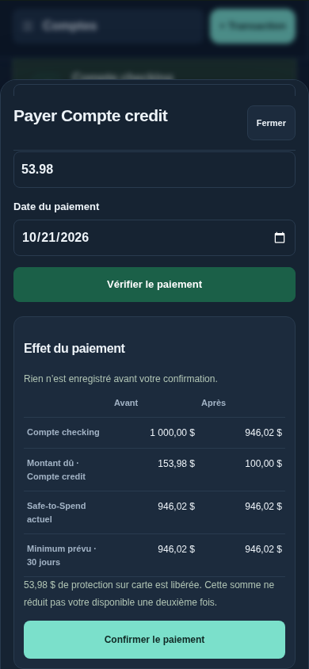

# Sillage 13.1.0 — payer une carte et mieux utiliser l’iPhone

## Installation

Téléchargez et décompressez [la v13.1.0](https://github.com/alexforget82/Budget/archive/refs/tags/v13.1.0.zip), puis ouvrez **Applications → Sillage → Mettre a jour Sillage.command** et choisissez le nouveau dossier complet. Actualisez Safari et vérifiez **v13.1.0** dans la navigation. Les données existantes et les liens Tailscale/vues simplifiées restent conservés. Aucun changement de schéma SQLite.

## Paiement réel d’une carte

1. Enregistrez l’achat sur la carte dans Transactions et associez-le au prévu ou à son enveloppe, si applicable. Ne recréez pas un achat déjà confirmé.
2. Faites votre paiement auprès de votre banque.
3. Dans Sillage : **Comptes → votre carte → Payer cette carte**. Le compte du budget (Conjoint si configuré) est présélectionné. Le montant proposé est celui des achats encore protégés, ou le solde dû s’il n’y a aucune protection. Modifiez-le pour indiquer ce que vous avez réellement payé.
4. Choisissez **Vérifier le paiement**. L’aperçu n’enregistre rien : il montre le solde bancaire, le solde de la carte, le Safe-to-Spend actuel et le minimum prévu sur 30 jours avant/après.
5. Choisissez **Confirmer le paiement**. Un seul virement réel est enregistré, sans nouvelle dépense. Pour un paiement futur, utilisez toujours **Planifier les remboursements**.

Exemple : 1 000 $ au Conjoint, Apple One de 53,98 $ déjà enregistré et protégé sur la carte. Après son paiement de 53,98 $, le Conjoint passe à 946,02 $; la dette diminue de 53,98 $; le Safe-to-Spend reste à 946,02 $. La dette ancienne non protégée peut, elle, diminuer le disponible. Le tableau d’aperçu montre la différence, y compris pour un paiement partiel ou depuis un compte exclu.

Un remboursement prévu est reconnu si les comptes, le montant et une date proche correspondent de manière unique. Les paiements réels restant à associer sont signalés. Un paiement du même montant pour cette carte, ce compte et cette date déclenche un avertissement; il faut indiquer qu’il s’agit réellement d’un autre paiement pour continuer.

Une confirmation ne peut être utilisée qu’une fois. Si votre budget change sur un autre appareil, ou si l’aperçu date de plus de cinq minutes, vérifiez à nouveau. Après un redémarrage du serveur, les anciens aperçus doivent également être refaits.

**Sillage enregistre votre paiement; il ne transmet aucune instruction à votre banque.**

## Ajustements iPhone

- Champs de paiement et boutons suffisamment grands; texte des champs à 16 px pour limiter le zoom involontaire de Safari.
- Fenêtres limitées à la zone visible lorsque le clavier s’ouvre; défilement contenu et marges tenant compte des zones de sécurité.
- Barre de navigation inférieure masquée pendant la saisie avec le clavier. Le zoom volontaire reste distinct du clavier.
- En-tête du paiement opaque pendant le défilement, résultat et confirmation plus lisibles.
- Dans la vue de votre femme, le résultat « Oui / Non » reçoit le focus et est amené dans la zone visible après la vérification. Aucun nouveau lien n’est nécessaire.

Les essais utilisent Chromium, des largeurs de téléphone et une simulation des changements du viewport. Le comportement du véritable clavier iOS et de Safari est à vérifier sur vos appareils après installation.

## Vérifications

113 tests Node, 201 tests API historiques et 64 scripts Python passent. Les nouveaux parcours sont aussi relancés après les derniers ajustements. Voir [les contrôles](../TESTS.md) et [les résultats](v131/checks.json). Toutes les données de test et de capture sont fictives et temporaires.

[Aperçu en mode clair](v131/paiement-light.png)
