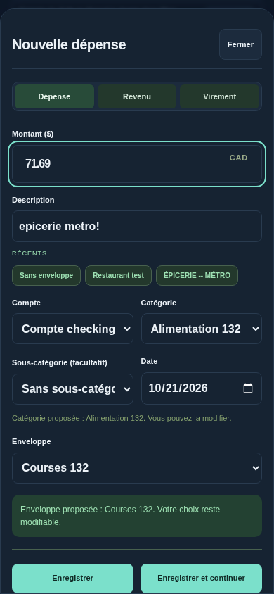
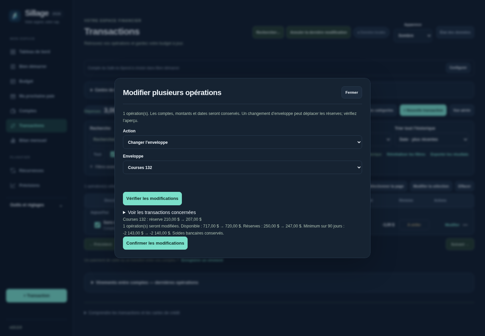

# Sillage 13.2 — phase 1

## Mise à jour

Téléchargez [v13.2.0](https://github.com/alexforget82/Budget/archive/refs/tags/v13.2.0.zip), décompressez, puis ouvrez **Applications → Sillage → Mettre a jour Sillage.command** et choisissez le nouveau dossier complet. Actualisez Safari. Les données et les liens iPhone existants sont conservés. Aucune migration de base n’est nécessaire.

## Classer une dépense

Choisissez l’enveloppe directement dans le formulaire de dépense. Lors des achats suivants au même commerçant, Sillage propose les derniers choix connus de catégorie et d’enveloppe. Les accents, la casse et la ponctuation ne changent pas le commerçant reconnu. Les numéros restent significatifs; aucun rapprochement approximatif n’est fait.

Choisir une enveloppe propose sa catégorie lorsqu’elle est unique; choisir une catégorie propose l’enveloppe lorsqu’elle est unique. Cela utilise l’historique et, à défaut, un nom identique unique. Une ambiguïté ne produit pas de proposition. Vous pouvez toujours changer ou effacer les champs : vos choix manuels restent prioritaires. Aucune configuration préalable dans Budget n’est nécessaire.

## Import CSV

Le préremplissage par commerçant s’applique aussi à l’aperçu CSV. Le sélecteur d’enveloppe permet de garder les propositions, choisir une enveloppe pour l’import ou choisir aucune enveloppe. Une catégorie fournie explicitement reste prioritaire; Non-catégorisé empêche sa proposition automatique. Vérifiez l’aperçu avant de confirmer. Modifier les choix après l’aperçu impose de le recalculer. Un import historique sans effet sur les soldes conserve ce comportement.

## Rattraper les dépenses sans enveloppe

Dans Transactions, cochez **Sans enveloppe** dans les filtres rapides. Le filtre porte sur toutes les dépenses, même si plusieurs pages existent. Sélectionnez les lignes voulues ou la page, puis **Modifier la sélection → Changer l’enveloppe**.

Choisissez une enveloppe et vérifiez l’aperçu : disponible actuel, minimum projeté sur 90 jours, réserves globales et par enveloppe. Aucune écriture n’a lieu avant la confirmation. Les catégories existantes restent celles des transactions; ce changement en lot porte sur l’enveloppe. Pour un long arriéré, répétez sur les pages suivantes.

Un changement d’enveloppe peut modifier la réserve et donc le Safe-to-Spend. Il conserve les dates, montants et mouvements bancaires existants. Si une ancienne association à une période doit être retirée, l’aperçu le signale. Les données historiques restent sans effet financier.

## Ce qui attend la phase 2

La période future n’est pas choisie automatiquement. Pour un achat effectué avant le renouvellement mais destiné au budget suivant, utilisez encore **Associer au prévu** et choisissez explicitement la période voulue. Les moteurs de calcul existants restent en place.

## Validation

117 tests Node, 201 tests API historiques et 68 scripts Python validés, avec relance des quatre parcours corrigés après le premier passage complet. Les essais utilisent des données fictives dans Chromium; ils ne remplacent pas une vérification sur votre iPhone. Voir [TESTS.md](../TESTS.md).
