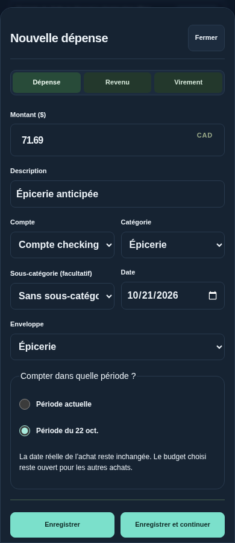
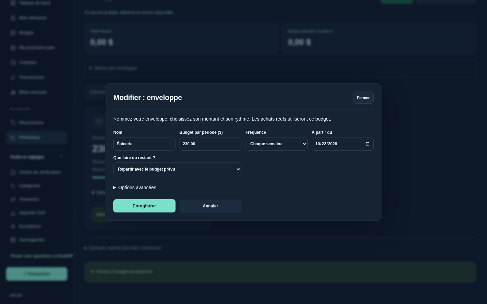
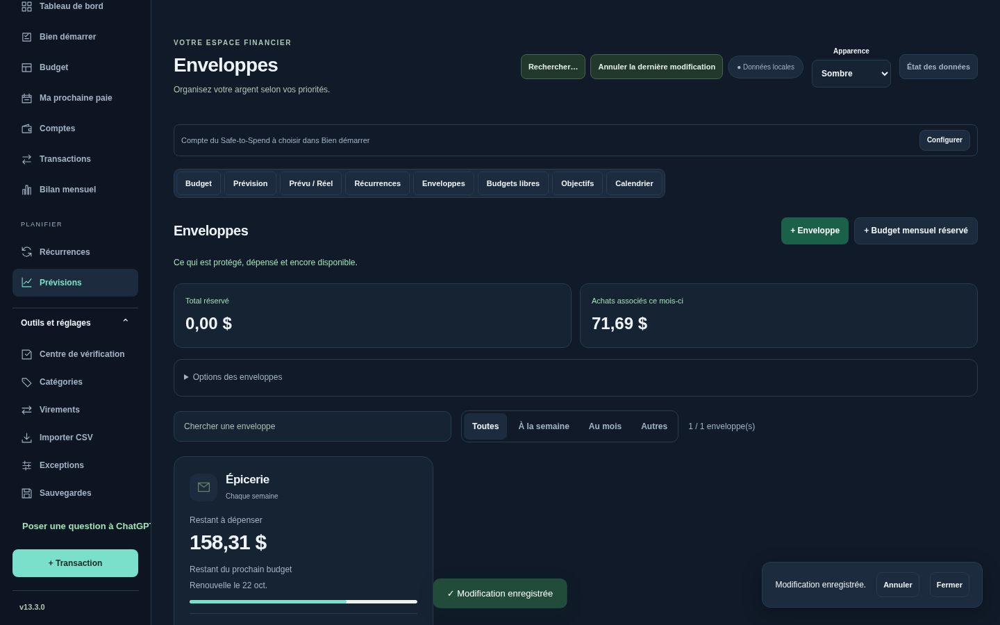

# Sillage 13.3 — phases 2 et 3

## Installer

Téléchargez [le ZIP v13.3.0](https://github.com/alexforget82/Budget/archive/refs/tags/v13.3.0.zip) et décompressez-le. Ouvrez **Applications → Sillage → Mettre a jour Sillage.command**, choisissez le nouveau dossier complet, puis actualisez Safari. Cette version comprend aussi la phase 1. Les données et liens iPhone sont conservés; aucune migration de schéma n’est nécessaire.

## Choisir la période pendant la saisie

Saisissez l’achat à sa vraie date et choisissez son enveloppe. Si un prochain budget protégé compatible se renouvelle dans les sept jours, une question apparaît : **Compter dans quelle période ?**

- **Période actuelle** conserve le comportement habituel, sans lien avec une période future.
- **Période du…** utilise explicitement ce budget pour l’achat anticipé.

Exemple : l’épicerie coûte 71,69 $ le 21 octobre et utilise le budget de 230 $ du 22. Choisissez la période du 22 : il reste 158,31 $ de ce budget. L’achat garde sa date du 21 et n’est débité qu’une fois. Le budget du 22 reste ouvert aux autres achats. Le lien est aussi lu par les prévisions et la vue partagée existantes.

Le choix est enregistré avec l’achat, dans la même opération. Si le budget change sur un autre appareil, la saisie reste ouverte et demande de vérifier à nouveau la période. Modifier les champs remet le choix à la période actuelle; vérifiez la question avant d’enregistrer. En cas d’échec de la vérification, l’enregistrement est bloqué pour éviter une association perdue.

Cette question concerne la création manuelle des achats en budget protégé. Les imports CSV et modifications en lot ne choisissent pas une période future automatiquement. Pour un achat déjà enregistré ou un paiement daté, les outils **Associer au prévu** existants restent disponibles.

## Une enveloppe plus simple

Le formulaire montre d’abord : nom, budget par période, fréquence, date de départ et traitement du restant. Les valeurs et règles de renouvellement sont conservées. Les réglages de réserve actuelle, compte, état et ancien mode de paiement restent dans **Options avancées**. Une enveloppe datée existante ouvre ces options pour rendre son mode visible.

Pour une nouvelle facture à date précise, utilisez **Programmer une facture dans Récurrences**, dans ces options. Le raccourci ouvre une nouvelle règle de dépense; il ne convertit ni ne supprime l’enveloppe affichée. Les anciennes enveloppes datées restent compatibles.

L’alimentation récurrente n’est pas proposée à la création pour les enveloppes ayant déjà leur renouvellement. Les anciennes règles restent accessibles en modification.

## Lire la carte

Le chiffre principal des enveloppes protégées programmées indique le **restant du budget** : budget de période moins achats associés à cette période. Avant le début, il indique le restant du prochain budget, avec ce libellé explicite. Ce montant n’est pas le solde bancaire ni le Safe-to-Spend. Les réserves réelles et les protections sur carte restent consultables dans les détails et la fiche. Les anciens paiements datés et budgets sans renouvellement conservent leur présentation financière propre.

**Gérer** ouvre la fiche commune pour saisir un achat, réserver, configurer, ajuster ou supprimer l’enveloppe. Les informations secondaires restent sous Détails du budget.

## Portée et validation

Les moteurs financiers et le schéma restent inchangés. La nouvelle saisie est comparée à l’ancien parcours en deux étapes, sur compte bancaire et carte : mêmes comptes, achats, liens et prévisions. Les contrôles incluent les choix périmés, montants modifiés, navigation sans écriture et affichage dans les deux thèmes.

117 tests Node, 201 tests API historiques et 70 scripts Python validés, avec trois relances ciblées après le premier passage complet. Tests sur bases fictives et Chromium, sans essai sur iPhone physique ou Safari réel. Voir [TESTS.md](../TESTS.md).

La phase 4 optionnelle, qui séparerait les modèles de budget et de paiement prévu, reste hors de cette version.
