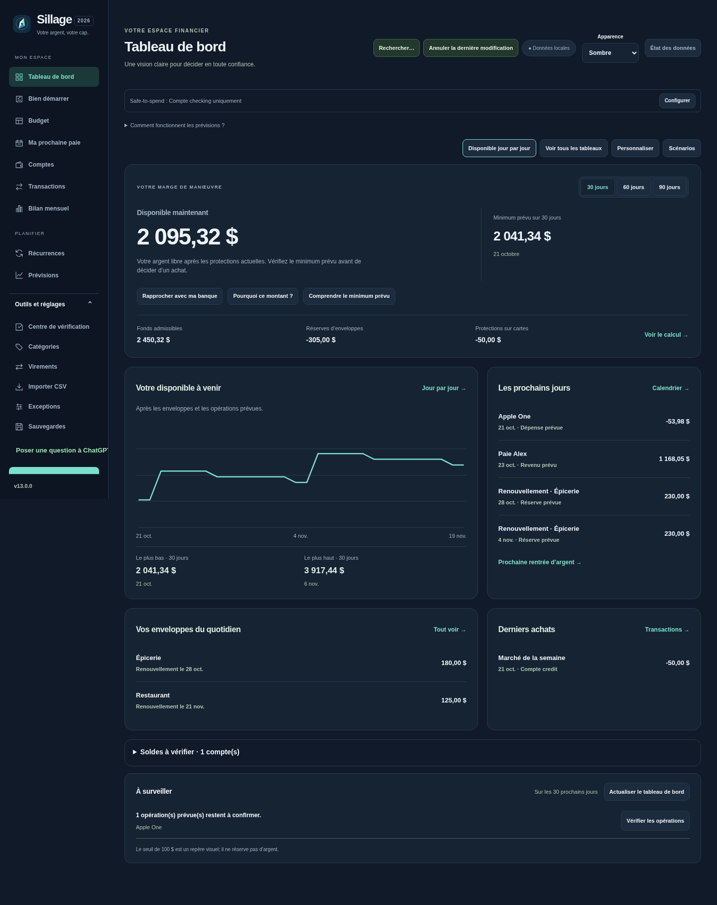
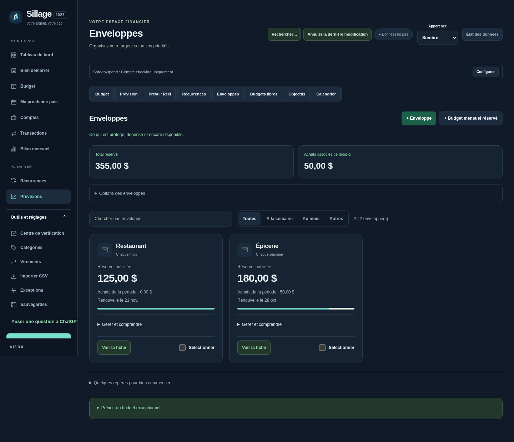

# Sillage 13.0.0 — votre nouvelle présentation

La maquette approuvée est intégrée au logiciel réel. Les captures ci-dessous utilisent des données fictives de test; votre installation affichera vos propres montants.

## Mettre à jour sur le Mac

1. Téléchargez et décompressez [Sillage v13.0.0](https://github.com/alexforget82/Budget/archive/refs/tags/v13.0.0.zip).
2. Ouvrez **Applications → Sillage → Mettre a jour Sillage.command**, puis sélectionnez le nouveau dossier complet décompressé.
3. Actualisez votre onglet Safari habituel. Vérifiez **v13.0.0** en bas de la navigation.

L’installation automatique conserve le dossier de données actif et sa sauvegarde avant mise à jour. Le schéma SQLite ne change pas. Aucun changement n’est nécessaire dans Tailscale; les adresses privées et le lien simplifié de votre femme restent valides. Sur son iPhone, actualisez la page ou fermez puis rouvrez la vue pour charger la présentation. Le raccourci de [retour à la v11.1](RETOUR-11.1.md) reste disponible.

## Ce qui change

- **Tableau de bord** : disponible actuel mis en évidence, minimum prévu, détail des protections, graphique et extrêmes sur 30/60/90 jours, prochains mouvements, enveloppes et derniers achats. Les boutons **Disponible jour par jour**, **Voir tous les tableaux**, **Personnaliser** et **Scénarios** conservent leurs fonctions.
- **Enveloppes** : réserve inutilisée, achats de la période et prochaine date sur une carte compacte. Recherche sans distinction d’accents et filtres par fréquence. **Gérer et comprendre** donne accès aux détails, à l’ajustement et à la suppression. **Voir la fiche** conserve l’historique et le financement. Les outils de groupe sont dans **Options des enveloppes**, qui s’ouvre aussi lorsqu’une enveloppe est sélectionnée.
- **Ordinateur et téléphone** : thème harmonisé, typographie et espacements revus, montants sur une ligne, navigation existante conservée. La vue simplifiée garde ses informations et reçoit les mêmes finitions.

Les cartes d’enveloppes affichent la **réserve inutilisée**, qui est de l’argent effectivement protégé maintenant. L’objectif moins les achats reste un autre repère, consultable dans les détails : un objectif futur n’est pas présenté comme une réserve déjà alimentée. Le moteur existant continue de protéger les périodes futures dans la prévision. Les achats sur carte restent protégés sans double déduction.

## Vérifications

110 tests Node et 201 tests API passent. Les 62 parcours Python sont validés, avec cinq relances ciblées après le premier passage. Les contrôles de chiffres et de conservation des données historiques restent actifs; les anciennes attentes de styles identiques sont remplacées par celles de la refonte approuvée. [Relevé](v13/checks.json).

Le nouveau parcours v13 couvre huit largeurs, deux thèmes et neuf écrans; vérifie les montants contre le serveur, la navigation sans changement des tables financières, les filtres, l’édition et le rafraîchissement des enveloppes, le mode détaillé et la vue partagée. Essais sous Chromium avec bases temporaires. La validation sur votre Safari et votre iPhone reste à faire sur vos appareils.

[Aperçu iPhone du tableau de bord](v13/dashboard-dark-390.png) · [Enveloppes sur iPhone](v13/enveloppes-dark-390.png) · [Enveloppes en mode clair](v13/enveloppes-light-1440.png) · [Vue simplifiée](v13/partage-iphone.png)
