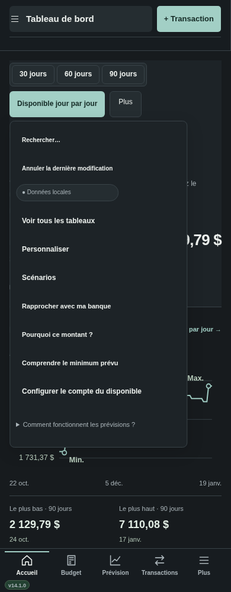
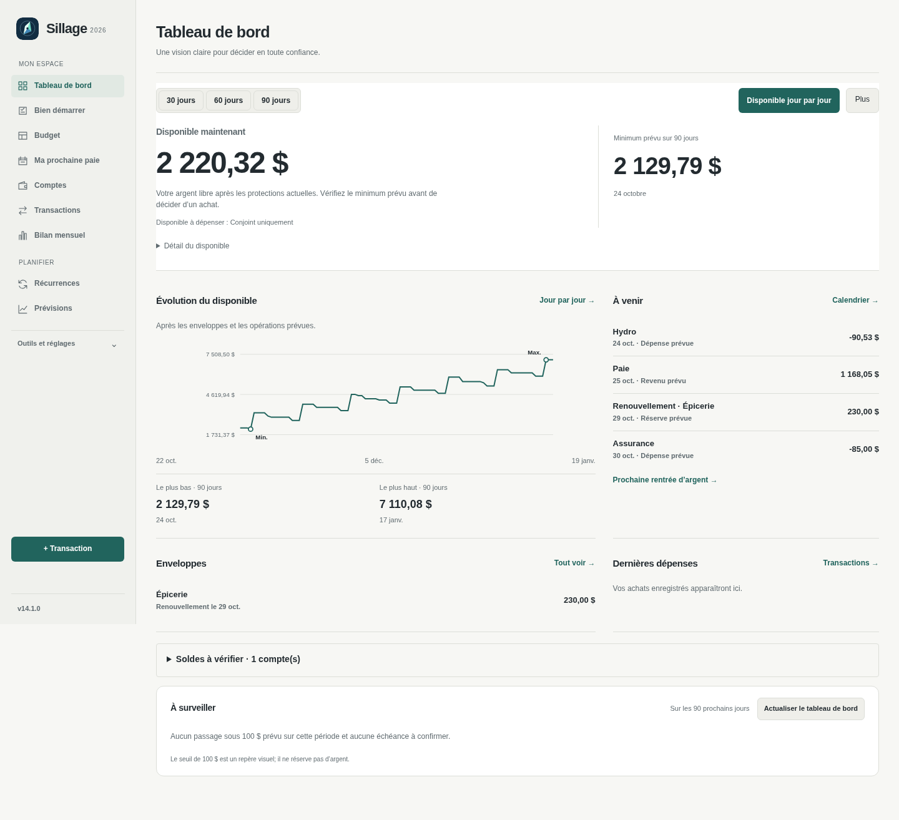
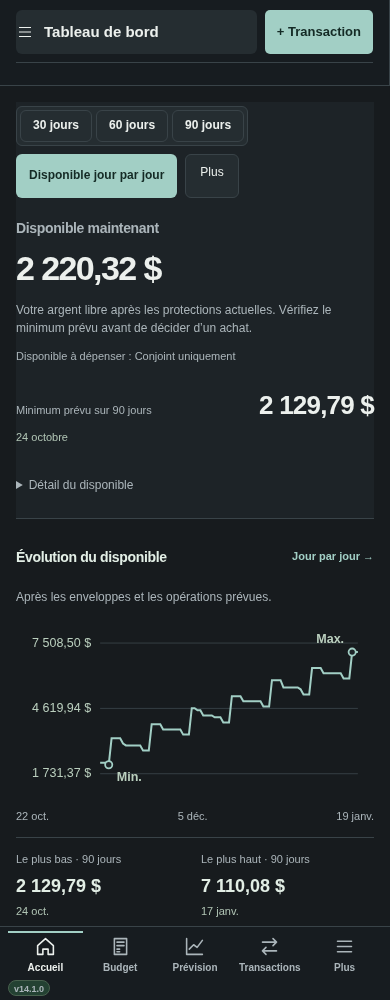

# Sillage v14.1

## Installer

[Télécharger v14.1.0](https://github.com/alexforget82/Budget/archive/refs/tags/v14.1.0.zip), puis décompresser le dossier complet. Ouvrir **Applications → Sillage → Mettre a jour Sillage.command** et choisir ce dossier. Actualiser Safari; sur iPhone, utiliser **Recharger l’interface** si proposé. Les liens privés existants sont conservés. Le numéro affiché doit être **v14.1.0**.

## Un tableau de bord allégé

Les sélecteurs **30 / 60 / 90 jours**, **Disponible jour par jour** et le menu **Plus** restent en tête. Plus contient recherche, annulation, vue détaillée, personnalisation, scénarios, rapprochement bancaire, configuration du compte et explications. Le menu se ferme après une action, avec Échap ou en cliquant ailleurs. Sur téléphone, il tient dans la largeur disponible et peut défiler.

**Apparence** et **État des données** sont dans **Outils et réglages**, sur ordinateur et téléphone. Sur les autres écrans, les commandes globales sont dans Plus sur ordinateur et dans le menu complet sur téléphone.

Le minimum prévu occupe la partie droite du bloc principal. Le libellé du compte devient **Disponible à dépenser : Conjoint uniquement** lorsque Conjoint est le compte choisi. Le détail du calcul reste accessible sous le montant.

Le graphique montre une échelle en dollars et marque le minimum et le maximum de la période sélectionnée. Les valeurs et dates complètes restent sous la courbe. Le montant actuel fait partie des points comparés, comme dans les chiffres du tableau de bord; changer d’horizon ne change pas le disponible actuel.

## Trois corrections

- **Précision :** les montants contenant une fraction de cent sont refusés à l’entrée au lieu d’être arrondis silencieusement. Les montants existants ne sont pas réécrits. Les cas `1.005` et `10.005` sont vérifiés, ainsi que le refus déjà présent dans l’import CSV.
- **Achat financé :** lors d’une modification financière, la couverture d’enveloppe issue d’un virement de Bien démarrer est prise en compte comme à la création, avec celle du compte alloué. Le cas est reproduit avec un achat entièrement financé puis corrigé de 100 à 90 dollars; la réserve n’est plus consommée à nouveau. Un simple changement de description était déjà neutre et le reste.
- **Calendrier bancaire :** Noël et le lendemain observés ne tombent plus sur la même journée. En 2027, les deux jours sont les 27 et 28 décembre. Le 30 septembre et le 11 novembre sont inclus; le dernier jour ouvrable recule aussi devant un férié. Cela concerne les règles utilisant les ajustements bancaires ou le dernier jour ouvrable. Les dates fixes sans ajustement ne bougent pas.

Aucune migration SQLite, aucune suppression ni réécriture des transactions historiques. Les corrections s’appliquent aux validations, modifications et dates calculées concernées; elles ne réparent pas automatiquement d’anciennes opérations déjà enregistrées.

## Styles consolidés avant les retouches visuelles

Les sept feuilles actives sont regroupées en quatre sources : `styles-foundation.css`, `styles-domains.css`, `styles-sillage.css` et `styles-tokens.css`. Les styles téléphone et les ajouts v13/v14 sont intégrés dans la présentation commune. Les anciens fichiers restent de petites redirections pour conserver les liens compatibles.

La comparaison avant/après consolidation, avant modification du tableau de bord, porte sur neuf écrans, deux thèmes, deux largeurs et 11 516 éléments : aucun écart sur les 27 propriétés contrôlées. 51 règles identiques et 63 anciennes définitions globales de palette sont retirées. Les priorités nécessaires sont conservées; il ne s’agit pas d’une suppression générale des `!important`.

[Relevé CSS](v141/css-consolidation.json) · [Architecture et règles de modification](ARCHITECTURE.md) · [Tests](../TESTS.md).

**120 tests Node, 201 tests API historiques et 73 scripts Python validés**, dont quatre parcours adaptés puis relancés après le passage complet. Les essais utilisent des bases fictives temporaires et Chromium. Safari réel et un iPhone physique restent à valider sur vos appareils.
