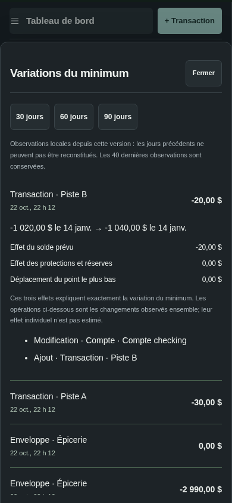
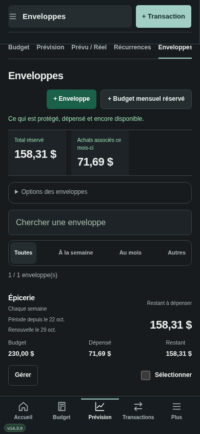
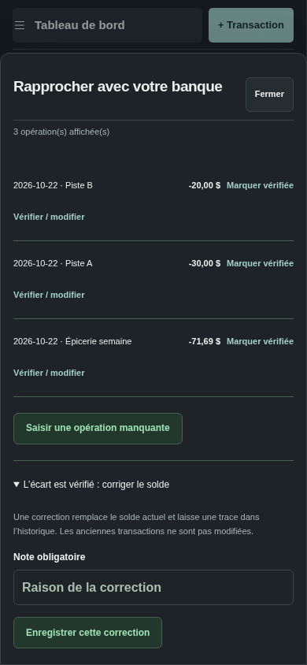

# Sillage v14.3 — comprendre son disponible

Cette version réunit les améliorations proposées pour les v14.2 et v14.3.

## Installer

[Télécharger v14.3.0](https://github.com/alexforget82/Budget/archive/refs/tags/v14.3.0.zip), décompresser puis ouvrir **Applications → Sillage → Mettre a jour Sillage.command** et choisir le dossier complet. Actualiser Safari; sur iPhone, utiliser **Recharger l’interface** si proposé. Le numéro affiché doit être **v14.3.0**. Les liens privés existants sont conservés.

## Pourquoi mon minimum a changé ?

Depuis **Plus → Pourquoi mon minimum a changé ?**, ou le lien sous le disponible, choisir 30, 60 ou 90 jours. Chaque ligne montre la variation, le changement principal et l’heure. Ouvrir une ligne pour comparer le minimum avant/après et les dates concernées. Un détail ouvert reste ouvert lorsqu’on change d’horizon.

Quand la date du nouveau minimum était déjà observée, trois lignes expliquent exactement la différence :

- le changement du solde bancaire prévu à cette date;
- le changement des protections et réserves;
- la différence due au déplacement de la date du minimum.

Les opérations, enveloppes, associations et réglages modifiés sont listés comme contexte. Si plusieurs changements arrivent ensemble, leur effet individuel n’est pas estimé. Lorsque la fenêtre avance, les dates qui sortent ou entrent peuvent changer le minimum. Si le nouveau point bas est une date jusque-là hors de l’horizon, aucune décomposition antérieure à cette date n’est inventée.

**Le journal commence après installation.** Il ne permet pas de retrouver les minimums des jours précédents. Il conserve les 40 dernières observations ayant changé la trajectoire, y compris celles dont le minimum global reste identique. Une simple consultation identique, un thème ou une coche de révision ne crée pas de variation.

Ce journal reste local, séparé du budget et de la vue de consultation de votre conjointe. Une restauration de sauvegarde ou un effacement complet le fait repartir de zéro. Les sauvegardes budgétaires existantes ne contiennent pas ce journal. Si son stockage échoue, le budget reste utilisable et l’historique affiche une erreur.

## Enveloppes : une période claire

Les budgets protégés présentent **Budget · Dépensé · Restant**, le début de la période et le prochain renouvellement. Avant la première période, le prochain budget tient compte des achats anticipés explicitement associés. Un achat de 71,69 dollars dans un budget de 230 dollars laisse ainsi 158,31 dollars dans la période choisie.

La fiche **Gérer** met le restant à dépenser en premier. La réserve actuelle et les achats du mois se trouvent sous **Réserve et total du mois**. Le restant budgétaire et l’argent déjà protégé gardent leurs rôles distincts; aucun financement ni paiement supplémentaire n’est créé. Les budgets libres et paiements datés conservent leur présentation adaptée.

## Rapprochement : Comparer → Examiner → Valider

Depuis **Comptes** ou **Plus → Rapprocher avec ma banque** :

1. Choisir le compte, saisir le solde bancaire et comparer sans modifier.
2. Examiner les opérations, doublons potentiels, échéances dues et combinaisons proposées.
3. Valider le rapprochement si les soldes concordent, ou ouvrir la correction uniquement après vérification de l’écart.

Une échéance due du même montant peut signaler une opération manquante. Deux opérations dont le retrait expliquerait l’écart constituent une autre piste; elles ne sont pas déclarées fausses ou supprimées. Les signes tiennent compte des cartes de crédit. Les pistes portent sur les 100 dernières transactions affichées et restent limitées; le relevé bancaire demeure la référence.

**Examiner** ouvre les éditeurs existants. **Voir cette échéance** mène à sa date de prévision. Les aperçus, notes obligatoires, confirmations et refus de données périmées sont conservés. Sillage n’exécute aucun mouvement bancaire.

## Vérification

Les essais utilisent des bases fictives temporaires. Les montants de période et de prévision proviennent du moteur existant; aucun schéma ni calcul financier n’est modifié. Le curseur ne revient plus automatiquement dans Montant lorsqu’on a déjà choisi Description ou un autre champ après ouverture de la saisie. Les nouveaux parcours vérifient quatre largeurs de 320 à 1440 pixels, les deux thèmes, les menus, le défilement des dialogues, la reprise après erreur et l’absence d’écriture financière pendant la consultation.

**126 tests Node, 201 tests API historiques et 75 scripts Python validés**, dont quatre parcours corrigés ou adaptés puis relancés.

[Résultats détaillés](v143/checks.json) · [Tests](../TESTS.md) · [Architecture](ARCHITECTURE.md). Aucun essai sur Safari réel ou iPhone physique; cette validation reste à faire sur vos appareils.
