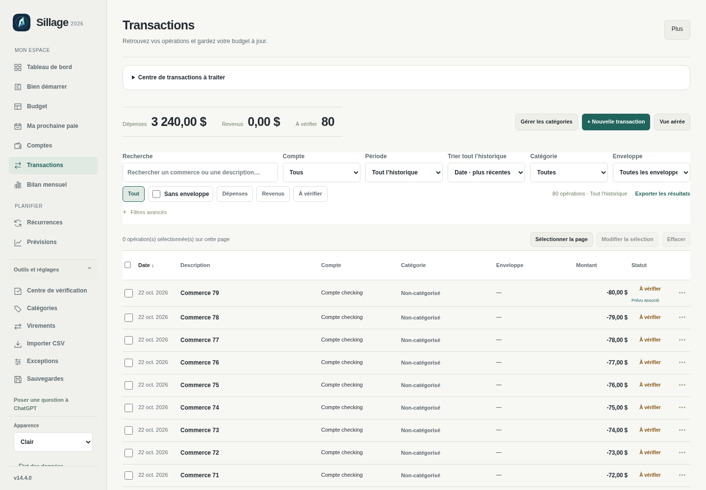
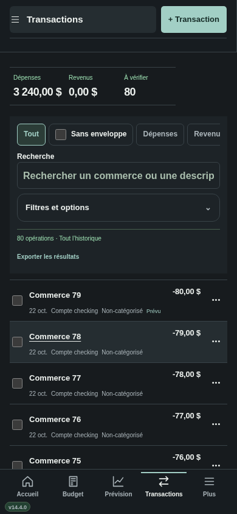
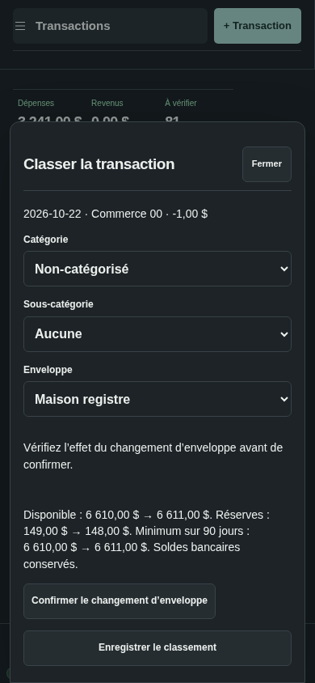

# Sillage v14.4 — le registre de transactions

## Installer

[Télécharger v14.4.0](https://github.com/alexforget82/Budget/archive/refs/tags/v14.4.0.zip), décompresser le dossier complet puis ouvrir **Applications → Sillage → Mettre a jour Sillage.command**. Choisir ce dossier et actualiser Safari. Sur iPhone, utiliser **Recharger l’interface** si proposé. Le numéro affiché doit être **v14.4.0**. Les données et les liens privés existants sont conservés.

## Lire davantage d’opérations

Sur ordinateur, chaque ligne présente date, description, compte, catégorie, enveloppe, montant et statut. Les montants sont alignés à droite et l’en-tête reste visible pendant le défilement. Les cases et le menu ⋯ encadrent les données. Les séparateurs quotidiens sont remplacés par une date dans chaque ligne.

Le registre affiche 50 opérations par page, avec le total des résultats. Le choix existant **Vue compacte / Vue aérée** reste disponible. Un clic sur la description ouvre la fiche de consultation; **⋯ → Modifier** ouvre l’éditeur complet pour changer date, montant, compte ou autres champs.

## Sur iPhone

Description et montant occupent la première ligne; date, compte et catégorie occupent la seconde. Les textes longs sont abrégés dans la liste et restent consultables dans la fiche. Les informations ne demandent pas de défilement horizontal. Les filtres secondaires sont dans **Filtres et options**, puis **Filtres avancés** si nécessaire.

Le menu ⋯ conserve consulter, modifier, refaire, supprimer, diviser une dépense et réviser, selon l’opération. Il ajoute **Changer le classement**. Les cases de sélection disposent d’une zone tactile élargie.

## Classer depuis une ligne

Sur ordinateur, cliquer directement sur la catégorie ou l’enveloppe. Sur téléphone, choisir **⋯ → Changer le classement**. Le petit formulaire présente catégorie, sous-catégorie et enveloppe. Aucune autre donnée n’est modifiée.

- **Catégorie / sous-catégorie :** enregistrer le classement. Le budget utilise ensuite la catégorie choisie, comme auparavant; les soldes, réserves et prévisions restent identiques.
- **Enveloppe :** demander l’aperçu, vérifier disponible, réserves et minimum sur 90 jours, puis confirmer explicitement. Le changement réutilise le traitement existant des réserves et peut modifier les protections ou les associations au prévu.

Si une association explicite sera retirée, le formulaire le signale. Une association automatique reconnue est aussi signalée comme susceptible de changer. Modifier un choix efface l’aperçu; une modification concurrente du budget impose de vérifier à nouveau. Fermer avant confirmation ne valide pas l’aperçu. Un message confirme l’enregistrement et la page courante est conservée lorsque possible.

Les catégories et enveloppes restent des choix indépendants dans cet éditeur : changer la catégorie ne réaffecte pas automatiquement l’argent à une autre enveloppe. Les revenus ne proposent pas d’enveloppe.

## Filtrer, trier et sélectionner

Recherche, compte, période, catégorie, sous-catégorie, enveloppe et révision portent sur tout l’historique. Les titres Date, Description, Compte, Catégorie, Enveloppe et Montant trient l’ensemble des résultats; le tri est indiqué dans l’en-tête. L’export CSV utilise les mêmes filtres.

La case d’en-tête sélectionne **la page affichée**. Les commandes de modification en lot existantes restent disponibles. Le repère **Prévu associé**, abrégé **Prévu** sur téléphone, indique une association reconnue par le moteur; il ne crée aucun lien. Une opération sans ce repère peut être une dépense courante sans échéance prévue.

## Vérification

Les nouveaux tests utilisent 80 opérations pour l’interface et 65 pour les filtres API. Ils vérifient alignement, densité, six largeurs de 320 à 1920 pixels, les deux thèmes, pagination, sélection, tri, export complet, classement sans effet financier, aperçu sans écriture, changement de formulaire, refus de jeton périmé, compte/date/montant conservés et accès à l’éditeur complet sur téléphone.

**126 tests Node, 201 tests API historiques et 77 scripts Python validés**, après adaptation et relance de deux parcours qui ouvrent désormais Modifier dans le menu ⋯.

[Résultats détaillés](v144/checks.json) · [Tests](../TESTS.md). Aucun moteur financier ni schéma modifié. Les essais emploient Chromium et des bases fictives temporaires; aucun essai sur Safari réel ou iPhone physique.
