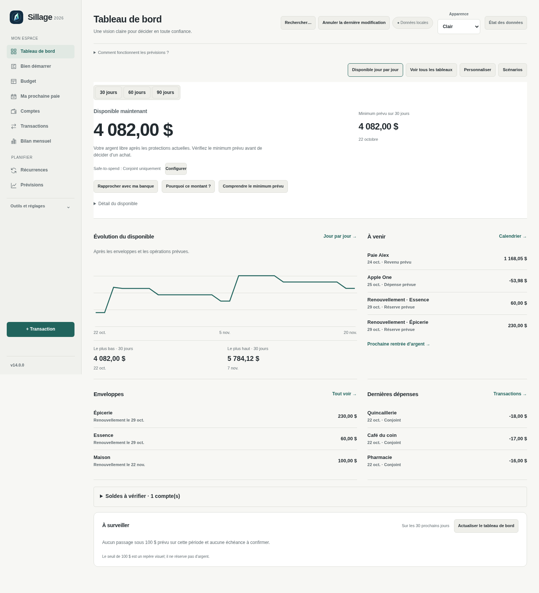
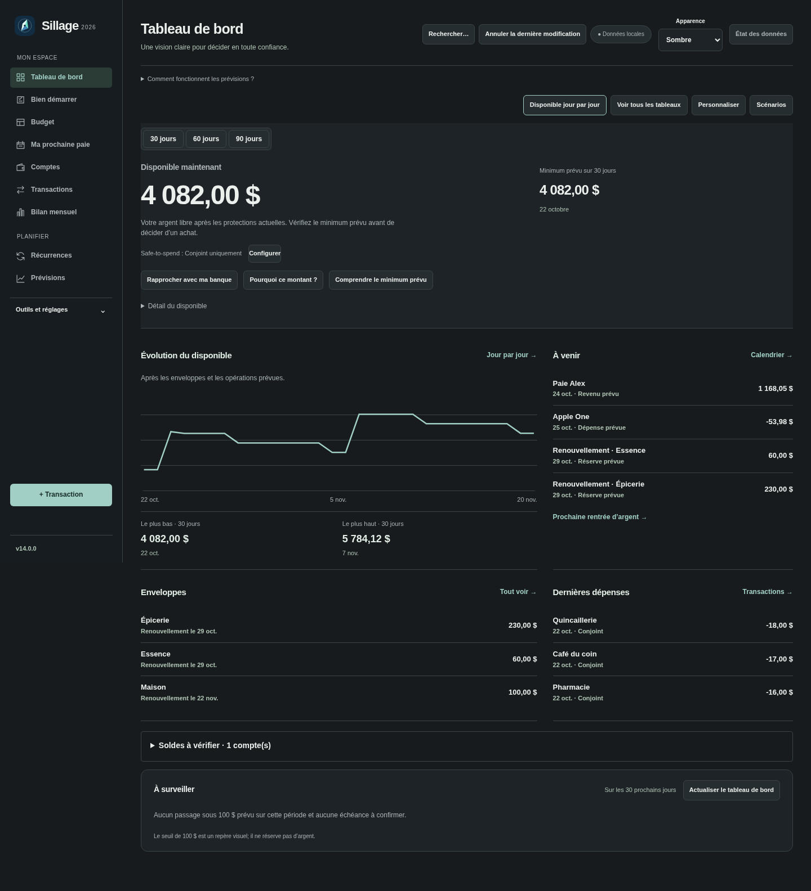
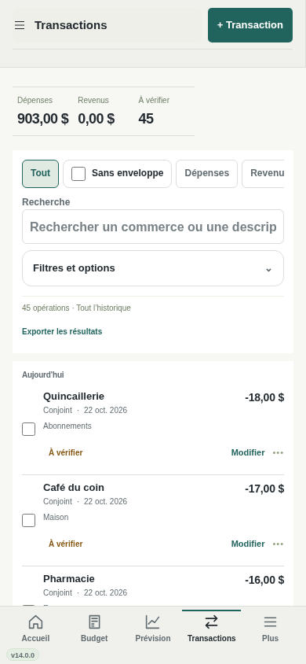
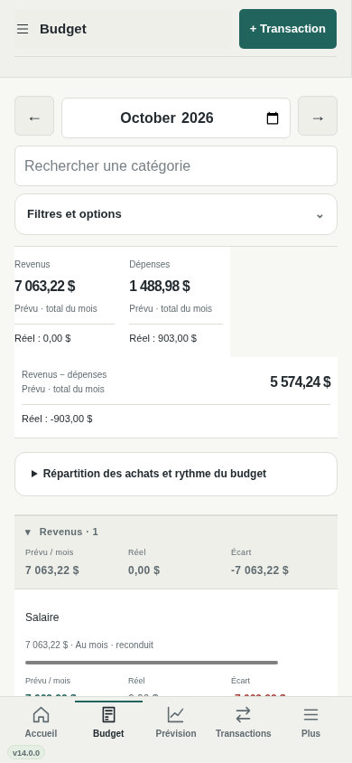
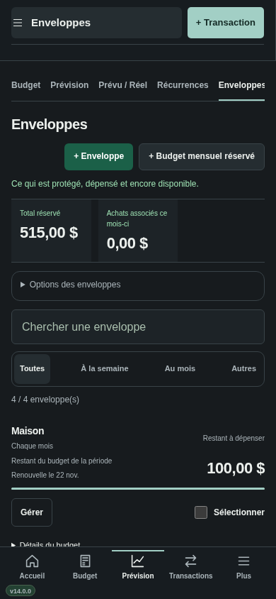
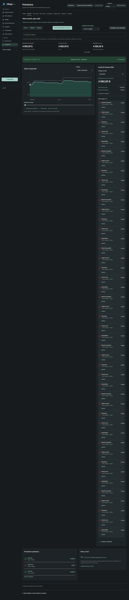
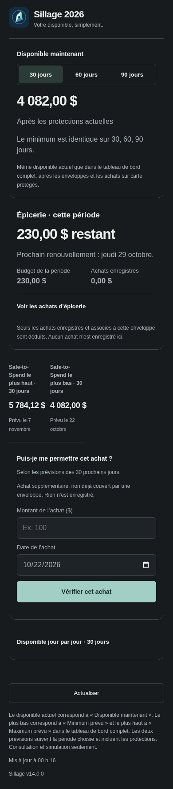

# Sillage v14

## Installer

[Télécharger v14.0.0](https://github.com/alexforget82/Budget/archive/refs/tags/v14.0.0.zip), puis décompresser le dossier complet. Ouvrir **Applications → Sillage → Mettre a jour Sillage.command** et choisir ce dossier. Actualiser Safari. Si l’iPhone affiche une nouvelle version disponible, choisir **Recharger l’interface**. Les liens privés existants sont conservés.

## Une présentation plus sobre

La v14 réduit les grands encadrés, les titres promotionnels et les boutons répétitifs. Une palette neutre, une typographie commune, des séparateurs fins et des nombres alignés organisent la lecture. Le Safe-to-Spend reste l’information principale; les autres écrans donnent davantage de place aux lignes de données.

## Tableau de bord

Le disponible actuel, son minimum prévu et la trajectoire restent issus des mêmes calculs. Le **Détail du disponible** se déplie pour retrouver les réserves, protections et l’explication complète. Le compte du Safe-to-Spend apparaît maintenant près de ce montant, avec son bouton Configurer, plutôt que dans un bandeau sur toutes les pages.

Les raccourcis jour par jour, explications, rapprochement bancaire, vue détaillée, personnalisation et scénarios sont conservés. Le minimum, les alertes et les différents horizons gardent leur sens actuel.

## Transactions et budget

Les filtres et totaux sont plus compacts; les montants restent entiers, sans retour à la ligne dans les centimes. Les dates, catégories, recherche, pagination, statut de révision et modification en lot restent accessibles. Le mode de densité existant est conservé.

Le budget garde les mêmes objectifs, fréquences, exceptions, sous-catégories, activités réelles et écarts. Les trois totaux sont regroupés dans une bande plutôt que dans de grandes cartes. Les onglets de planification utilisent une ligne de sélection discrète.

## Enveloppes

La liste remplace la grille de grandes cartes. Chaque ligne présente le nom, le restant, la prochaine période et **Gérer**. Les détails de réserve restent sous **Détails du budget**; la sélection et les outils de groupe restent disponibles.

Le restant du budget, le solde bancaire et le Safe-to-Spend demeurent des notions distinctes. Les avances, les achats anticipés et les protections sur carte conservent les règles de la v13.3.

## Prévisions et calendrier

Les mêmes courbes, dates, scénarios et opérations restent consultables, avec des surfaces plus simples et des libellés courts. La sélection d’une journée reste visible, et les valeurs négatives gardent un signal distinct.

## Vue simplifiée partagée

Le lien de consultation de votre conjointe fonctionne toujours. Disponible, épicerie, simulation Oui/Non et liste quotidienne sont conservés. Les montants les plus haut et plus bas sont présentés côte à côte et suivent toujours 30, 60 ou 90 jours.

## Vérification

117 tests Node, 201 tests API et 71 scripts Python validés, dont deux parcours relancés après correction de défauts d’affichage. Les tables financières sont comparées avant/après navigation et les montants affichés sont vérifiés contre l’état serveur. Les thèmes et petits écrans sont contrôlés avec Chromium et des données fictives; Safari réel et un iPhone physique restent à vérifier chez vous.

Aucune migration de base ni modification des moteurs de calcul. Voir [les détails des tests](../TESTS.md).
