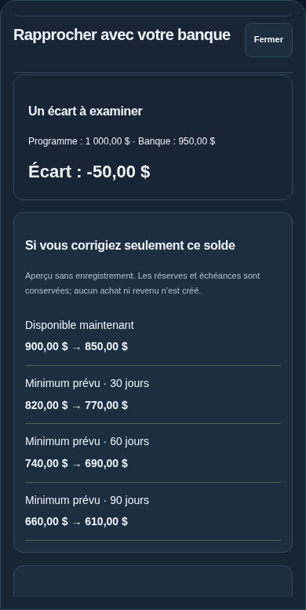

# Comprendre et vérifier son disponible — v11.6.0

## Calcul visible

Dans le tableau de bord, ouvrir Pourquoi ce montant ?. Les lignes Solde bancaire inclus et Argent protégé ouvrent leurs détails. Le disponible actuel reste la soustraction canonique des fonds inclus et des protections. Les achats sur carte protégés sont distingués des réserves encore dans les enveloppes. Les revenus, paiements et virements futurs sont intégrés à leurs dates, sans seconde déduction du disponible actuel. Le sélecteur de date et le chemin quotidien existants expliquent les prévisions.

## Vérifier un compte

Le tableau de bord présente l’état des comptes bancaires inclus : jamais vérifié, à revérifier ou rapprochement à jour. La date de la dernière validation reste visible. Une validation signifie seulement que les soldes saisis concordaient; elle ne garantit pas que la banque n’a pas reçu de nouveaux mouvements.

Ouvrir Vérifier sur le compte voulu, saisir le solde bancaire actuel, puis Comparer sans modifier. Pour une carte, saisir le montant dû positif, pas le crédit disponible. Le résultat présente l’écart et l’effet théorique d’une correction de ce seul solde sur le disponible actuel et les minimums 30/60/90 jours. Les réserves, échéances et règles de carte sont conservées. Deux calculs utilisent le moteur existant, sans écrire dans la base.

Examiner les pistes de doublons et les opérations enregistrées, puis saisir les opérations manquantes si nécessaire. Si les soldes concordent, la validation explicite enregistre un point de vérification. Sinon, une correction reste proposée séparément, avec note obligatoire et contrôle du solde attendu. Une modification des comptes ou opérations reçue par l’interface efface l’aperçu affiché. Le contrôle serveur du solde attendu et le contrôle d’empreinte des validations restent conservés.

Les aperçus ne sont pas une autorisation de dépense et ne signifient pas que le relevé bancaire est synchronisé. Les informations de vérification restent réservées à la vue propriétaire; le lien simplifié reste limité aux données déjà partagées.

## Validation

Deux nouveaux tests API comparent l’aperçu au résultat réel d’une correction sur une base temporaire et vérifient les comptes exclus/cartes. Un nouveau parcours navigateur couvre les liens du calcul, les statuts de vérification, l’absence de changement financier pendant consultation, l’invalidation d’un aperçu, la validation explicite, deux thèmes et trois largeurs. Les tests historiques de rapprochement et d’explication conservent leurs assertions financières.

Les essais de navigateur utilisent Chromium Linux; Safari/iOS et une véritable installation macOS restent à confirmer sur appareil. Aucun schéma SQLite modifié. Le retour à la v11.1 reste disponible.

## Aperçu sur téléphone

Capture Chromium, thème sombre, données fictives :

