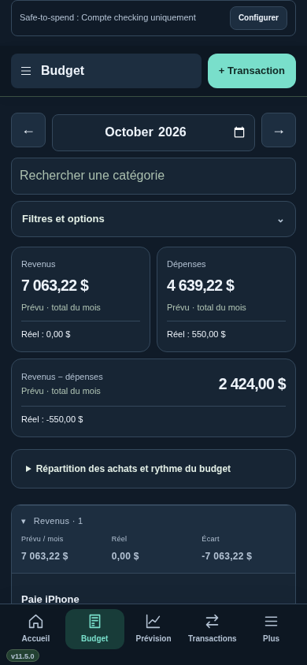
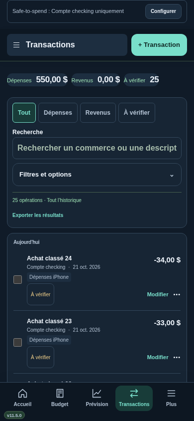
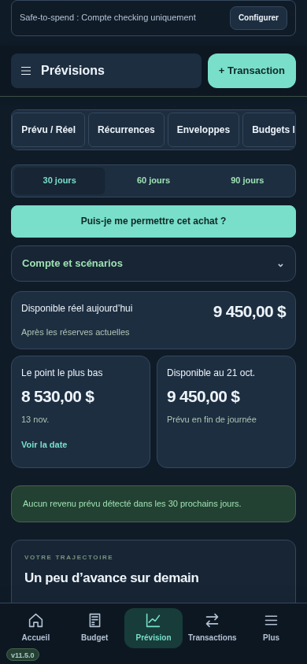

# Interface iPhone — v11.5.0

La barre du bas ouvre Accueil, Budget, Prévision et Transactions. Plus ouvre le menu complet et le choix clair/sombre. Le numéro de version reste en bas à gauche.

Budget présente le mois sur une ligne, les revenus et dépenses sur deux cartes lisibles, puis le résultat. Les actions de copie, de démarrage et les filtres sont dans Filtres et options. Transactions conserve la recherche et les filtres rapides visibles; les opérations prennent la priorité. Prévision regroupe les options de compte et de scénarios. Le calendrier commence en semaine sur téléphone; le mois reste disponible.

Les contrôles existants sont déplacés, puis remis à leur place sur ordinateur. Aucun changement aux calculs financiers ni au schéma de base. La vue simplifiée reçoit seulement une disposition plus compacte.

## Aperçus

Captures sur données fictives, Chromium en contexte tactile 390 × 844, thème sombre :

## Vérifications

Le parcours mobile contrôle cinq largeurs (320, 375, 390, 430 et 760 pixels), neuf écrans, les deux thèmes, les montants sans débordement, les menus, les filtres, les sélections multiples et les fenêtres de saisie. Une réduction simulée du viewport vérifie la position de la fenêtre au-dessus du clavier. Le retour à la disposition ordinateur et une saisie de transaction sont vérifiés. La consultation conserve les tables financières et la prévision exacte.

Les essais utilisent Chromium sur Linux. Safari/iOS, le clavier réel et les zones de sécurité d’un véritable iPhone restent à confirmer sur appareil.

## Installation

Sur le Mac : Applications → Sillage → Mettre a jour Sillage.command, puis sélectionner le dossier complet décompressé de la v11.5.0. Actualiser ensuite Safari sur Mac et iPhone. Les données restent dans le dossier de service existant. Le raccourci de retour à la v11.1 est conservé.
