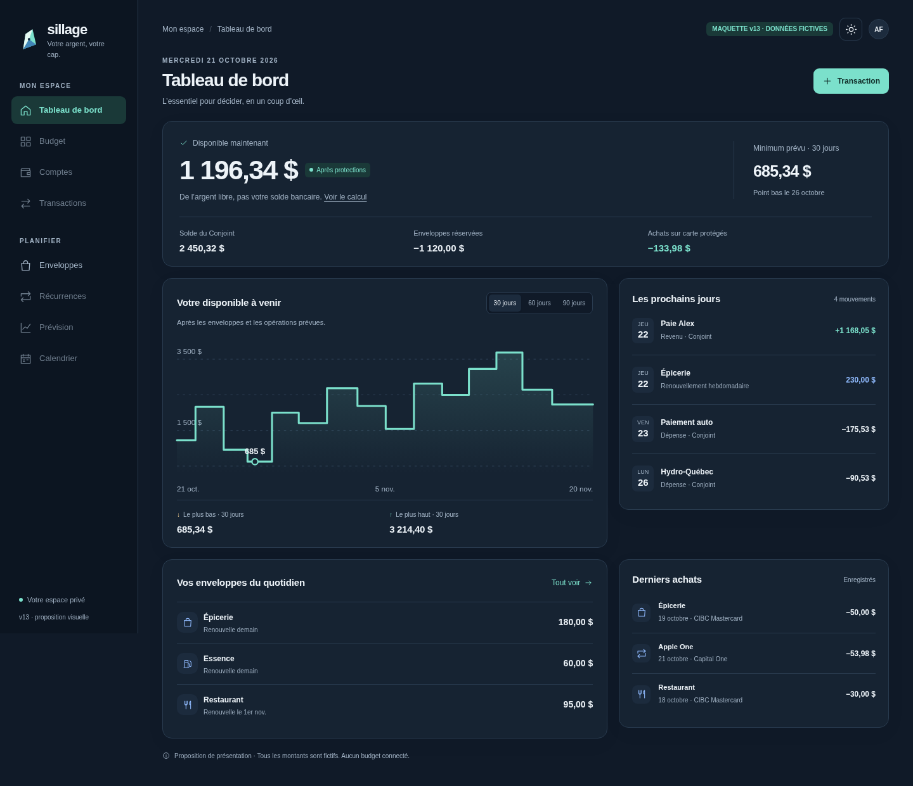
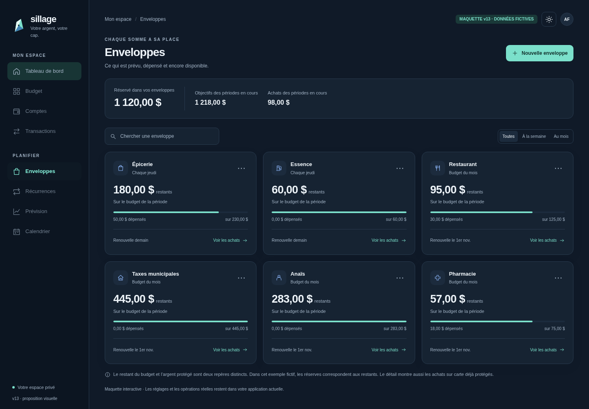

# Sillage — proposition visuelle v13

Prototype autonome du tableau de bord et des enveloppes, avec des données fictives. L’application publiée reste en v12.0.0. Ouvrir `index.html` après extraction de `../Sillage-v13-maquette.zip`.

La proposition comprend une navigation adaptée au téléphone, des montants lisibles, une explication du disponible, des horizons illustratifs 30/60/90 jours, une recherche d’enveloppes, des filtres et deux thèmes. Les actions de création ne sont pas implémentées dans ce prototype.

Vérification dans Chromium via Playwright : sept largeurs de 320 à 1920 pixels, absence de débordement horizontal, navigation, filtres, ouverture des détails, thèmes et changement d’horizon sans modification du disponible actuel. Aucune erreur JavaScript observée. Pas de validation sur un appareil iOS réel; la politique du navigateur de test bloque les URL `file://`, les tests ont donc utilisé un serveur HTTP local. Le fichier est autonome et ne contient aucune ressource externe.

